# Gitter

Gitter is a simpler native Git client for macOS — an alternative to Tower and GitKraken
without the feature bloat. It opens a repo, browses branches and the commit graph, and
shows diffs, all live-refreshed as the working copy changes. It stages files, hunks and
even single lines, and commits — including amend and "commit all tracked" — from those
diffs. It creates, switches, merges, renames and deletes branches, checks out remote
branches and tags, and ends an operation the repository is stuck part-way through. It talks
to remotes: fetch, pull and push the current branch, publish a branch, show how far each
branch is ahead of and behind its upstream, and keep that picture current with a quiet fetch
in the background. And it can now put work aside and throw it away: stash all or some of
your changes and bring them back, and discard a file, a hunk or a single line — every
discard leaves a copy, and a notice offers **Undo Discard**. When a merge, rebase, cherry-pick
or revert stops on a conflict, it resolves it in the app — block by block, or a whole file at
a time — and then continues, skips the commit or commits, with the stopped commit's message in
the composer. It also starts those operations: select commits and cherry-pick or revert them,
rebase the current branch onto a commit or a branch — each behind a sheet that lists exactly what
will run — and create, delete (with **Restore Tag**), push and remotely delete tags. And it
keeps the remotes tidy: it prunes remote-tracking branches the server no longer has — naming the
commits only they held and keeping a branch at each on request — cleans up branches whose
upstream is gone, pushes or fast-forwards a branch that is not checked out, sets or unsets an
upstream, and adds, renames, re-points or removes a remote.

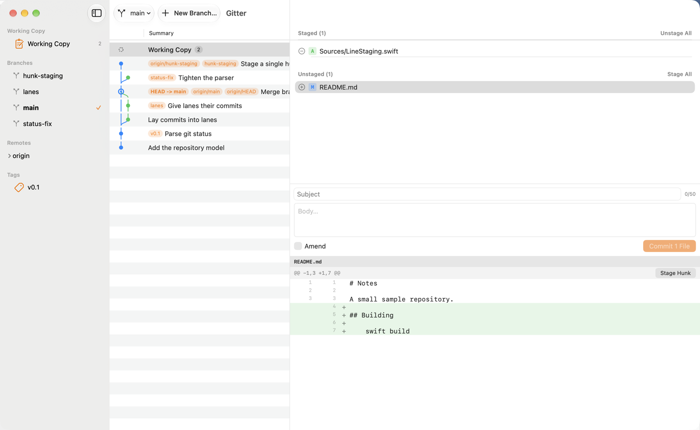

## What it can do

- Browse commit history with a lane graph (gitk-style)
- View diffs of a commit, or of the working copy, with wrapping long lines
- Stage and unstage whole files, individual hunks, or a hand-picked set of lines
- Commit, amend the last commit, or commit every tracked change in one step
- Create, switch, rename and delete local branches; check out a remote branch as a local
  tracking branch; check out a commit or a tag (detached HEAD)
- Merge, choosing each time between fast-forward if possible, always a merge commit, and
  squash — the last choice is remembered
- **Resolve conflicts** in the app: each conflict as blocks, ours beside theirs (the base on
  request), with Ours, Theirs, Both (ours first) or Both (theirs first) per block and the result
  shown before anything is written; whole-file choices for what git cannot draw blocks for
  (binary files, symlinks, a mode change, deletions); Open in Editor and **Mark Resolved**; and
  **Reopen Conflict…** while the operation is still going (see "Conflicts" below)
- **Continue** a stopped rebase, cherry-pick or revert from the operation bar ("Rebasing feature
  onto 5e248b9: stopped at commit 1 of 3 …"), with the stopped commit's message in the composer
  to keep or edit, or **Skip This Commit…**; commit a merge or a squash with git's prepared
  message; or end any of them: abort a merge, cherry-pick, revert, rebase or `git am`, and undo
  a pending squash
- **Cherry-pick** or **revert** one or several selected commits (⌘-click, ⇧-click) as one git
  sequence, in the order git needs — the sheet lists them, and the ones left out or likely skipped
  as already applied; **rebase** the current branch onto a commit or a branch, with the commits it
  replays, the merges it flattens and a warning when some are already pushed (see "History actions
  and tags" below)
- **Tags**: create one, annotated or lightweight, on any commit; delete it behind a confirmation,
  with **Restore Tag** afterwards; push one tag to a remote, or delete one there, leased on the id
  the sheet showed; tag pills on the commit rows and a tooltip with the tagger, date and message
- Hooks and commit signing apply as configured, because every commit runs through
  your own `git`, not a reimplementation of it
- Fetch, Pull and Push from the toolbar (Repository menu: ⇧⌘F, ⇧⌘L, ⇧⌘P). The running one
  shows, once it has run for 0.4 s, a spinner, git's own progress line and a Stop button
  (⌘. works from the start); browsing is never
  blocked, and a fetch does not block staging or committing either
- Pull fast-forwards when it can and says so in a notice (`Fast-forwarded to
  "origin/main".`); when both sides have moved on it asks, Merge or Rebase, with the counts —
  the last answer is remembered
- Publish a branch that has no upstream (`push -u`), choosing the remote when there is more
  than one (`origin` preselected); Re-publish one whose upstream was deleted on the server
- A hosting service's pull-request link after a push stays on screen, with **Open** and
  **Copy Link**, until you close it, push again or open another repository — the link whole,
  without any user name or token; so do the notices with a button (Pop Stash, Undo Discard)
  and the one after a drop, while plain notices still fade after a few seconds
- When the server refuses a push because it has commits you don't, the banner offers
  **Pull** and **Force Push…**; the force push is leased on the exact sha it showed you
- Delete a branch on a remote from the sidebar ("Delete on "origin"…"), with a warning that
  says whether its commits are held anywhere else
- Ahead/behind badges on the branch button and the sidebar's branches: `↑2 ↓3`, "gone" when
  the upstream was deleted, and `↑1 · main` when the upstream is a local branch; the Pull and
  Push buttons carry the same counts
- Copy a remote's URL from its sidebar menu, with any password or token taken out
- **Prune** a remote (Remotes ▸ Prune "origin"…, or the remote's sidebar menu): the sheet lists
  every remote-tracking branch the server no longer has with its full id, the commits only they
  hold — counted once — and a ticked "Keep … as" branch for each ref that alone holds some (Keep
  All / Keep None); **Clean Up Gone Branches…** then deletes the local branches whose upstream is
  gone, the merged ones ticked, the others with the unmerged warning (see "Remotes housekeeping"
  below)
- **Push** or **Fast-Forward** a branch that is not checked out, from its sidebar menu — never
  forced, and a fast-forward only when the branch has nothing of its own and no worktree uses it;
  **Set Upstream…**, **Change Upstream…** and **Unset Upstream** on any local branch
- **Add Remote…**, and **Edit URL…**, **Rename…** and **Remove…** on a remote's row: the URL as
  configured, a credential never shown, an `insteadOf` rewrite as a line beside it; the removal
  sheet lists every ref it deletes with its id, the commits it would strand (keepable), and the
  branches left with no upstream or pushing elsewhere. A remote with no URL is in the sidebar,
  marked "no URL", and nothing talks to it until it has one
- **Stash** every change or only the selected files, with a message and, if you ask, untracked
  files too (Repository ▸ Stash Changes…, ⌥⌘S, or **Stash…** in the working copy). The sidebar's
  **Stashes** section lists them; selecting one shows its files and diff read-only, untracked
  files under their own heading. Apply, Pop, and Drop Stash… behind a confirmation, from the
  row's menu
- **Discard** unstaged changes by file, hunk or line, a staged file back to the last commit, or
  an untracked file into the Trash — always behind a sheet that says what goes and where the
  copy is kept, and always with **Undo Discard** afterwards (see below)
- **Stash and Continue**: a switch, merge or pull refused because of your local changes offers
  to stash them and run the same action again; the stash is then offered back (**Pop Stash**),
  never popped by itself
- Fetch quietly in the background: when a repository opens and every 10 minutes after,
  unless **Repository ▸ Fetch Automatically** is unticked (on by default). It never shows a
  banner — a failure is only a small mark on the Fetch button, with the reason in its
  tooltip — and it never stands in your way: Fetch, Pull and Push stay available while it
  runs, and using one stops it (yours starts once the stopped fetch's git has gone — at once
  for a transport that honours the stop, about 2 s for one that ignores it)
- Quit safely while the network is busy: a fetch or pull is stopped and Gitter quits; a push
  (or publish, force push, delete on a remote) asks first — **Wait** lets it finish and then
  quits (or stays open if it failed or has a warning, so you can read it, or if it is still
  running after ten minutes), **Stop and Quit**, or **Don't Quit**

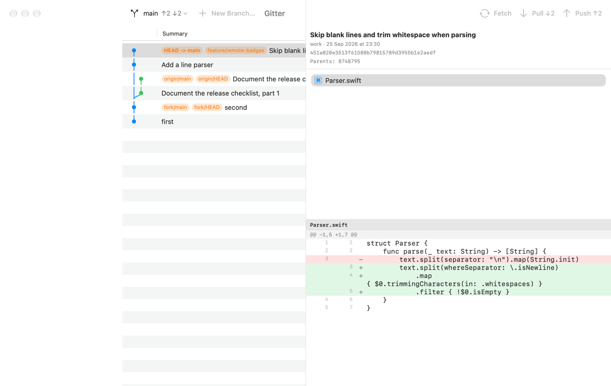

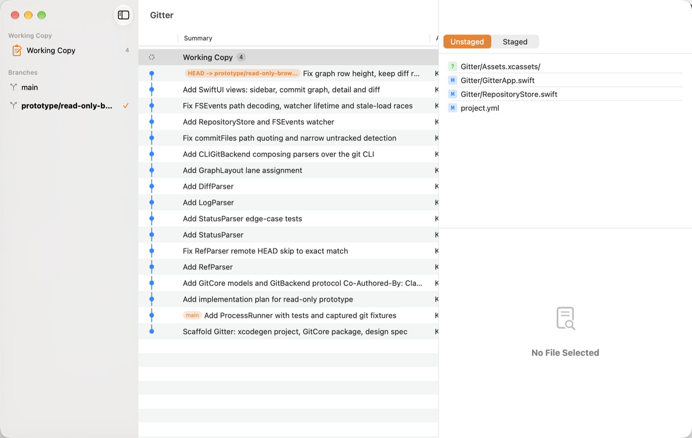

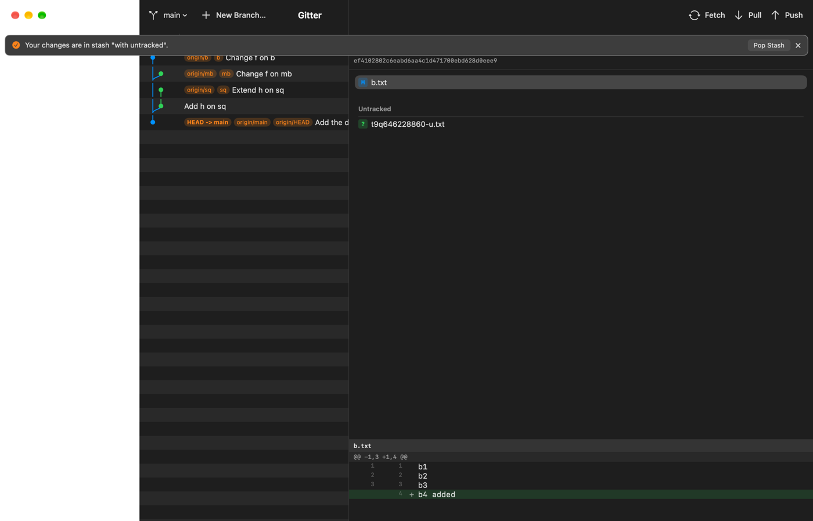

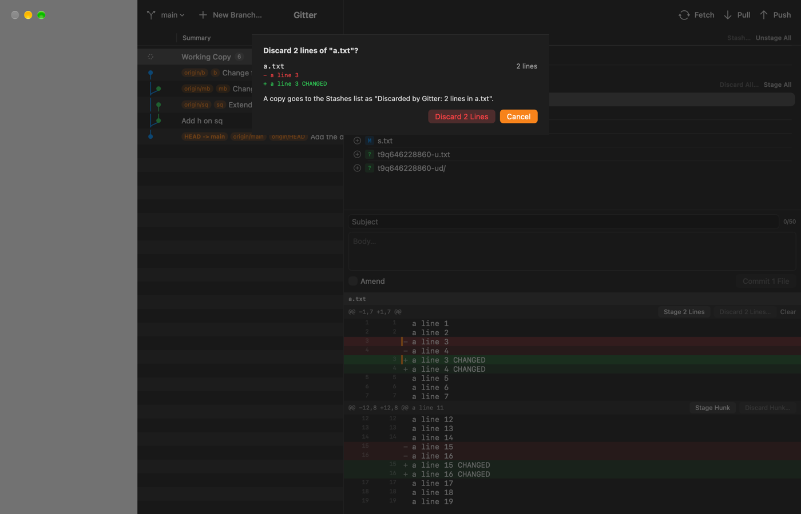

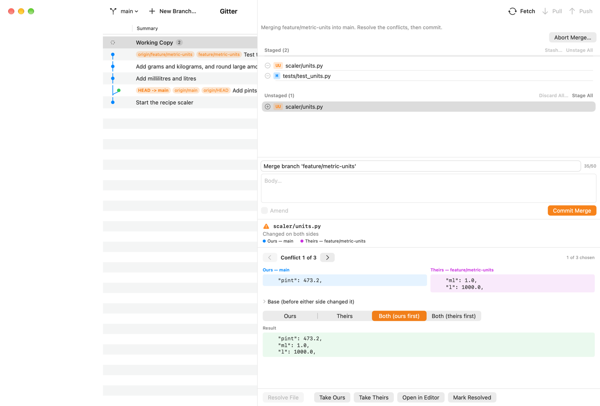

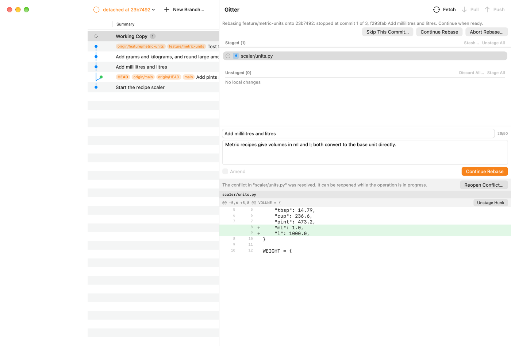

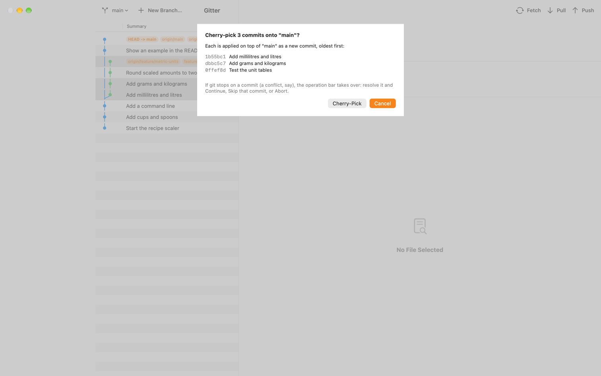

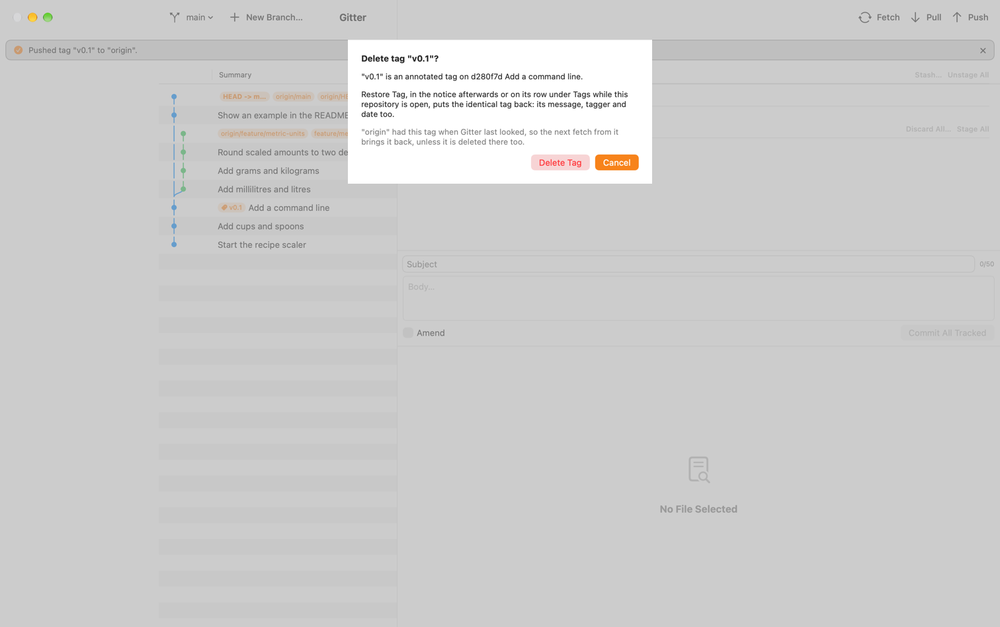

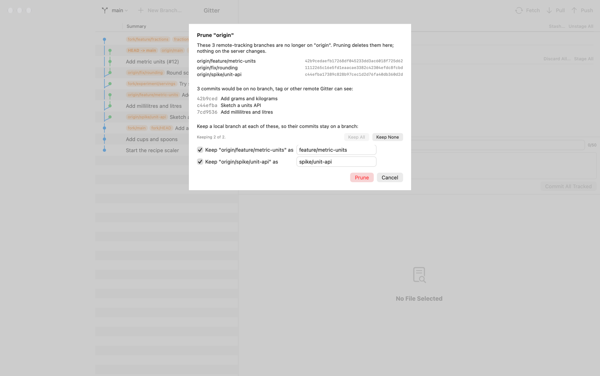

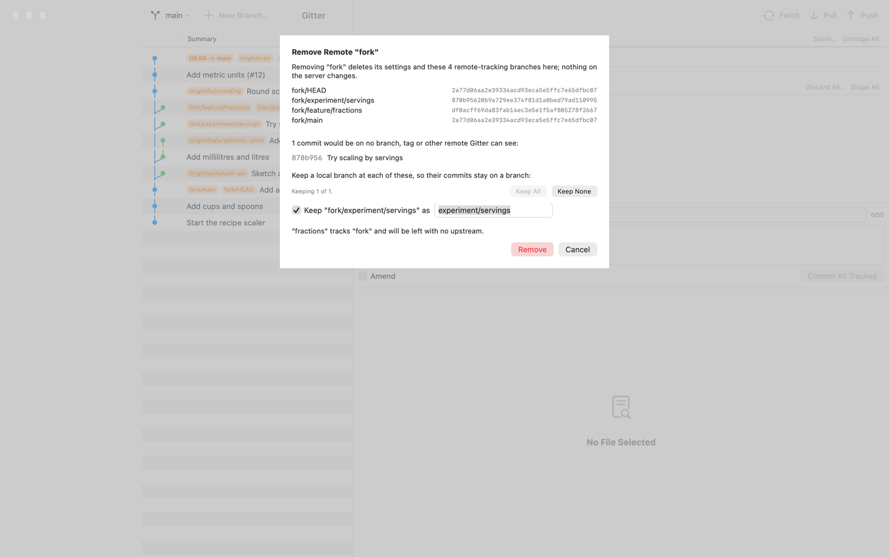

## Safety

Staging and unstaging change only the index (`git apply --cached`, `git add`, `git reset`)
and committing writes only to the repository. Branch operations change the working tree,
since that is what a checkout is; remote operations change another machine; and stash and
discard take changes out of your files, which is their whole point. So the promise is
restated rather than dropped — in the design's words:

> **Gitter never discards uncommitted work or commits without a confirmation that names
> what will be lost** — and a discard also leaves a copy that can be brought back.

Switch, detach, track and merge run plain git with **no force flag anywhere in the code**
(`--force`, `-f`, `--discard-changes`, `-B`, `-C`, `--merge` on switch are forbidden, and
a test greps the sources for them on every run). When git refuses, nothing has changed,
and Gitter shows the files git named rather than a wall of stderr. The same test forbids,
for the network: a bare `--force-with-lease`, any refspec beginning with `+`, `--mirror`,
`--prune` (except in the prune sheet's listing, a `fetch --dry-run` that deletes nothing), `--all`
on push, `--tags` and `--follow-tags`, `--delete`/`-d` on push,
`--no-verify`, `--autostash`, `--update-refs` on rebase, and the `pull` subcommand itself
(Gitter fetches and then merges or rebases as two steps it controls). For the working copy
it allows `stash` only in five exact spellings — never with a pathspec, `--keep-index`,
`--staged`, `--all` or `-p`, and never `pop`, `clear`, `create`, `branch`, `show` or
`apply --index` — `restore` only with `--no-recurse-submodules`, and forbids `clean`,
`checkout`, `hash-object` and `--unidiff-zero` everywhere; `read-tree`, `update-index` and
`write-tree` may appear in one file only, the one that builds a discard's record in a
temporary index. For conflicts it allows `merge-file` only with `--object-id` (without it git
writes over its first argument), `restore --ours|--theirs|--merge` and `rm -q` only on one
path at a time, and `--skip` only as exactly `rebase --skip`, `cherry-pick --skip` or `revert
--skip`; `--quit` stays forbidden. A list of paths for `add`, `restore` or `rm --cached` goes
in a pathspec file rather than one argument per path: past 4 096 arguments macOS's `Process`
does not fail, it crashes the app, so every call is also checked before git starts. (Stage All
still passes its paths as arguments, `add -- <paths>` in batches of at most 1 000; only the
writes of a selection use the pathspec file.)

Fifteen actions can lose something without being asked for by name, and each is behind a
confirmation that says what goes and what stays:

| action | how it is confirmed |
|---|---|
| Abort a merge, cherry-pick, revert, rebase or `git am` | a sheet with that operation's own kept/lost wording — a rebase abort also takes unstaged edits, `am --abort` rewinds the branch past the patches it committed, a cherry-pick or revert range's abort past the commits it already made (named) — and **the exact list of files** it is about to put back, read live |
| Undo a pending squash | the same sheet: everything staged goes, including work staged before the squash if the squash was started outside Gitter, which is why the file list is not optional |
| Force-delete an unmerged branch | `git branch -d` runs first and either deletes or refuses *without changing anything*; only its refusal opens a warning naming the unique-commit count and the tip sha, and "Delete Anyway" is refused unless the branch still points at exactly that tip |
| Leave a detached HEAD holding commits on no branch, tag or remote | a warning naming the count and the full sha, with "Create Branch Here…" as the safe answer; leaving anyway prints the command that brings the commits back |
| **Force push** — only ever offered from a push the server refused because it has commits you don't | Gitter fetches, then a sheet names the remote and branch, shows **both shas in full** — the remote tip that will be replaced and your local tip that will be pushed — and lists the commits that will leave the server's branch, with their authors. On "Force Push" it re-reads your branch and refuses if it has moved since the warning; the push then carries `--force-with-lease=<remote ref>:<the remote sha shown>` and sends `<the local sha shown>:<remote ref>`, so what the server loses and what it gets are exactly what the sheet showed. If the server's branch moved meanwhile, git itself refuses (`stale info`) and nothing on the server changes |
| **Delete a branch on a remote** (sidebar ▸ remote branch ▸ "Delete on "origin"…") | Gitter fetches that remote, then a sheet names the branch, the remote and its tip in full, and says whether its commits are **held by no branch, tag or other remote Gitter can see** (and how many). The deletion is leased on that tip (`--force-with-lease=refs/heads/<b>:<tip>` with `:refs/heads/<b>`), so a branch that moved, or is already gone, is refused by the server and nothing is deleted. The notice afterwards prints the `git push <remote> <tip>:refs/heads/<b>` that recreates it |
| **Discard** — a file's unstaged changes, its staged and unstaged changes, a hunk, some lines, an untracked file, or Discard All | a sheet names every file with what it loses (`+12 −3`, `2 lines` with the lines themselves, `untracked → Trash`) and says where the copy goes. On confirm Gitter reads everything again and refuses if anything changed since the sheet was shown; then it **records** the tracked changes in the Stashes list before it touches a file, and moves untracked ones to the Trash (see "Stash and discard" below) |
| **Drop a stash** | a sheet names the stash's message, its files and its full sha, with a live warning if the list moves while it is up; the drop is refused unless the entry at that position is still that sha. The notice afterwards prints the `git stash apply <sha>` that brings it back until git's cleanup removes it |
| **Skip a commit** of a stopped rebase, cherry-pick or revert | a sheet names the commit and every file that goes back to how HEAD has it, resolved or not; Gitter first files their current contents in the Stashes list as `Skipped by Gitter: <sha> <subject>`, and skips only when every change in the working copy belongs to that commit — git's own `rebase --skip` resets every tracked file, your unrelated edits included |
| **Leave a commit out of a rebase** — Continue when the resolution leaves the stopped commit with no changes | "Leave d183fcd out of the rebase?": git would drop it without a word. When other files are staged the sheet says the opposite happens — the commit is kept, holding only them, under its own title and author |
| **Replace a hand-edited conflicted file** — Resolve File, Take Ours or Theirs, Delete or Keep on a file edited since git wrote the conflict | the sheet says the file changed since git wrote the conflict; the edited file is filed as `Replaced by Gitter: <file>` before anything is written |
| **Prune a remote** | Gitter asks the server which of the remote's branches it no longer has (a dry run that deletes nothing), then a sheet lists each remote-tracking branch with **its full id**, the commits that would be on no branch, tag or other remote afterwards — **counted once for all of them** — and a ticked "Keep … as <name>" for each ref that alone holds some. On Prune it counts again and refuses if more would be stranded, creates the kept branches first, then deletes each ref **only while it still holds the id the sheet showed** (`update-ref -d` with that id); one that moved is left alone and named. The notice lists every deleted ref with its id — a remote-tracking ref has no reflog to find it by |
| **Clean Up Gone Branches** | a sheet lists the local branches whose upstream is gone, each "merged" or "N commits only here"; merged ones are ticked, an unmerged one carries the unmerged-branch warning when ticked, and a branch checked out in a worktree cannot be ticked. Each is deleted only at the tip the sheet showed, after a recount; the notice lists every tip with `git branch <name> <id>` |
| **Remove a remote** | a sheet lists every remote-tracking ref git will delete with its full id, the commits that would be stranded (keepable, as for a prune), the branches that will have no upstream and the ones whose push silently goes to another remote. On Remove it reads all of that again and refuses on any difference; the notice is the only record of the deleted refs, each with its id and the `git update-ref` that brings it back |
| **Reopen a resolved conflict** | the sheet says what comes back — conflict markers; for a binary file ours' version, with no markers; for a mode conflict ours' mode — and the resolution is filed as `Reopened by Gitter: <file>` first |

Three more confirmations stand before a commit rather than a loss: **Mark Resolved** when git
still finds conflict markers in the file, **Continue** when files that are not part of the
stopped commit are staged (git commits everything staged into it, under that commit's title),
and **Stage All** during an operation when it would add files outside it — named from the very
list Stage All stages, untracked files included even when `status.showUntrackedFiles=no` hides
them from the file list, and nothing is staged if that list changed after you agreed. In the force push,
delete-on-remote, discard, drop, conflict and continue sheets Cancel holds Return and the
destructive button has no shortcut. A force push's sha is
spelled out rather than left to git on purpose: a bare `--force-with-lease` leases against
the remote-tracking ref, which Gitter's own automatic fetch rewrites — measured, in the
situation where the explicit lease answers `stale info`, the bare one force-pushed and took
a colleague's newest commit off the branch.

Pull with **Rebase** rewrites your local commits, and it is asked for by name: the pull
sheet says how many commits it rewrites, that it needs a clean working copy, and that a
merge commit among them is flattened rather than kept. It is never a default you did not
choose; the old tip stays in `ORIG_HEAD` and the reflog. A rebase that stops on a conflict
lands in the operation bar: resolve there and Continue, Skip the commit, or Abort, which puts
everything back.

Amending is the one more — fifteen confirmed actions, plus amend — and the one with no
confirmation sheet: it rewrites HEAD and leaves
the commit it replaces reachable from no branch, tag or remote. What stands in for the sheet
is that nothing else asks for it — you tick the Amend toggle yourself and the commit button
then reads "Amend Commit" — plus a warning, "Amending rewrites history that has already been
pushed.", when the branch tracks an upstream and has nothing ahead of it, which is exactly
when the commit being rewritten has already been pushed. And the replaced commit is still in
the reflog, as `HEAD@{1}`.

Amending is unavailable while any of those operations is in progress, and that is not
belt-and-braces: git refuses `git commit --amend` during a merge and a cherry-pick and
**accepts** it during a revert, a rebase, a `git am` and a pending squash (measured on git
2.54). Each of those four rewrites the commit the operation was standing on, leaving it
reachable from no branch, tag or remote, with nothing on screen to say so — the same kind of
loss the table above confirms, and one nobody would have been asked about. So Gitter refuses
all six itself, before git runs, and the Amend toggle says which operation is in the way.

A network write that is stopped or fails is **never reported as "nothing changed"**: a
stopped push says the remote "may or may not have been updated" and fetches to find out.
A stopped or failed fetch leaves the repository intact (no `*.lock`, `git fsck` clean).

The staging claim is verified by tests that read **every byte of every worktree file** before
and after each staging operation and require them to be identical (`worktreeSnapshot` keeps
the file contents, not a digest, so a failure can print what changed); every branch refusal is
tested the same way, with the index, HEAD and every ref compared as well, and every remote
refusal also compares every ref of the bare "server" repository.

### Credentials: whatever git already has

Gitter never sees, asks for or stores a secret. Every fetch, pull and push is your own
`git`, so your credential helper (the macOS Keychain helper included), your ssh-agent, your
`~/.ssh/config` and macOS ssh's Keychain passphrases (`UseKeychain`) all apply as they do in
a terminal. git is run with `GIT_TERMINAL_PROMPT=0`, so when it would have had to ask for
something it fails at once, and Gitter says what to do **once, in a terminal**:

- HTTPS with no stored login — "<url> needs a login that git doesn't have. Run git fetch once
  in a terminal to sign in; Gitter will use it afterwards." Run `git fetch` in that
  repository, sign in when git asks, and the credential helper remembers it.
- A key the server refused, or one git could not unlock — "<url> refused the login git
  offered. Run git fetch in a terminal to sign in again."
- An unknown ssh host key — "The server's host key isn't trusted yet. Connect once from a
  terminal (git fetch) to check its fingerprint and accept it."

**A passphrase-protected ssh key.** When the environment sets neither `SSH_ASKPASS` nor
`SSH_ASKPASS_REQUIRE`, Gitter starts its network git with `SSH_ASKPASS_REQUIRE=force`. A Mac
has no askpass program, so ssh can never ask for a passphrase or a host key — it fails in
about 50 ms with the real cause, however Gitter was launched. Before this, a Gitter launched
**from a terminal** had ssh stopped by the terminal (SIGTTOU) as it went to ask, before any
prompt was shown: the automatic fetch then hung until its 2-minute timeout, and a manual one
until Stop. Now it fails like any other refused key: load the key into your agent (`ssh-add`)
or let macOS keep its passphrase (`UseKeychain`), and Gitter uses it from then on. Your own
`SSH_ASKPASS`, `SSH_ASKPASS_REQUIRE`, `GIT_SSH_COMMAND` and `core.sshCommand` are never
touched; if you set `SSH_ASKPASS` without `SSH_ASKPASS_REQUIRE` and start Gitter from a
terminal, ssh's own rules apply and it can still be stopped there (see the backlog).

### What fetch and push deliberately do not do

- **No prune on fetch.** Gitter's fetch, manual or automatic, always passes `--no-prune`, even
  when `fetch.prune`, `remote.<name>.prune` or `fetch.pruneTags` is set: pruning can drop the
  last ref to a deleted branch's commits, so it has a confirmation of its own — **Prune
  "origin"…** (see "Remotes housekeeping"). Until you prune, a branch someone deleted on the
  server keeps its `origin/…` ref, and its local branch keeps counting against it; the **"gone"**
  badge appears after a prune — Gitter's or a terminal's — or after Gitter's own "Delete on …",
  which removes the one ref it deleted. A "gone" branch's Push button reads **Re-publish**.
- **No tags.** Every push passes `--no-follow-tags`, even when `push.followTags` is set,
  including a force push and a deletion — measured, git otherwise publishes annotated tags
  beside the one ref it was asked to push, even beside a delete.
- **One branch at a time** — the current one from the toolbar, another from its sidebar menu
  (**Push "b"**) — always by an explicit refspec (`refs/heads/<b>:<remote ref>`), to that
  branch's push remote (`branch.<b>.pushRemote` / `remote.pushDefault` are honoured).
  The force push is the one exception to the spelling, not to the rule: it sends the sha its
  sheet showed (`<sha>:<remote ref>`), so what lands is the commit you were shown even if the
  branch moved meanwhile — and if it did, Gitter refuses instead.
- **No submodules.** Every push passes `--no-recurse-submodules`: with `submodule.recurse` or
  `push.recurseSubmodules=on-demand` set, git otherwise pushes the submodule's branch to the
  submodule's own server too. (This also overrides `push.recurseSubmodules=check`.)
- **No autostash.** Pull's fast-forward and merge pass `--no-autostash`: with
  `merge.autoStash` set, git otherwise stashes an edit the pull would overwrite, reports
  success, and leaves the file with conflict markers. Gitter shows git's refusal instead.
- **No fetch into your own branches.** A fetch is only a read of the server while the remote's
  fetch refspecs write into `refs/remotes/`. One that writes anywhere else
  (`+refs/heads/*:refs/heads/*`, a `--mirror=fetch` remote) would move your local branches or
  tags on every fetch, so Gitter does not fetch that remote — it says so, with the `git
  config` line that fixes it — and fetches the others.

### Stash and discard: where your changes go

**Stash.** "All changes" is git's own `git stash push` (with `--include-untracked` when you
tick it). "Selected files" is not: a stash with a pathspec takes every staged file with it, so
Gitter builds the entry itself from exactly the files you picked, in a temporary index that
never touches yours, files it as an ordinary stash entry, and only then restores those files;
a selected untracked file goes into the entry first and then to the Trash. Apply never puts
back a stash's staged layer — git's `--index` would unstage your other staged files and can
lose a staged version — so everything comes back unstaged (a new file comes back staged). **Pop
drops the entry only after a clean apply**, and only if it is still the entry you picked: if
the list changed in between, the notice says it was applied but not dropped, and the entry
stays. A conflicting or refused apply keeps the entry. The one thing a stash does not keep is
an empty untracked folder, which git deletes; the sheet says so.

**Discard.** Tracked changes are **recorded first**: before any file is touched, Gitter files
a stash entry named `Discarded by Gitter: <files>` (or `Discarded by Gitter: 2 lines in
<file>`) holding exactly the discarded files as they were, both layers — so even a crash in
the middle leaves at worst an extra entry. Then git does the discarding: `git restore` puts the
unstaged side back to what is staged, or the staged side back to the last commit (index and
disk), and a hunk or line discard reverse-applies just those lines. **Untracked files and
folders go to the macOS Trash**, never deleted (a folder goes whole, ignored files in it too).
The sheet is a snapshot: on confirm everything it showed is read again, and if anything
changed — a file edited in your editor meanwhile — nothing is discarded.

**Undo Discard.** The notice after a discard stays until you close it, and its **Undo
Discard** puts things back:

- a file's unstaged changes: the record is applied again and then dropped;
- staged and unstaged changes: the same, then the staged part is staged again — unless a
  commit was made, or something about that file was staged, since; then the changes come back
  unstaged, and the notice says why;
- some lines: the same lines go back, but only onto the file exactly as the discard left it
  (its bytes, its staged version and HEAD) — anywhere else they could land in the wrong place;
- untracked items: each one comes back from the Trash; one whose name is taken again stays in
  the Trash, and nothing is overwritten.

Undo is refused rather than forced whenever a file changed since the discard, and the record is
dropped only when the file is back byte for byte. Whatever Undo cannot do, the copy is still
there: the `Discarded by Gitter` entry in the Stashes list (Apply it; a line discard's entry
holds the whole file, so stage that file's other changes first), and Finder's **Put Back** for
anything in the Trash. Applying or popping that entry yourself ends the notice's Undo.

Line and hunk discard are offered only where a patch can take exactly those lines: not for a
binary, renamed or non-UTF-8 file, a change that covers the whole file, or a file whose line
endings are not the ones a checkout writes (under `core.autocrlf`, git would rewrite every
line). There the hunk offers **Discard File…** instead. Nothing is stashed during a merge,
rebase, cherry-pick, revert, `git am` or pending squash (git's own stash silently ends some of
them), nor applied, popped or dropped while a file is still conflicted. Discard works during
one, except for a conflicted file (resolve it instead) and the staged side of a file the
operation itself changed — its commit would lose that change; a whole-file discard's **Undo**
then waits until the operation has ended (its `stash apply` would disturb it), and the copy
stays in the Stashes list meanwhile. Nothing is discarded for an intent-to-add (`git add -N`),
submodule or nested-repository path, nor where a file and a folder swapped places; tracked
files cannot be discarded before the first commit, since the record needs one.

### Stash and Continue

When a switch, a checkout, a merge (a squash too) or a pull is refused because of your local
changes, the error banner offers **Stash and Continue**. It stashes every change — untracked
files too when git named one in the way — as `Gitter: before switching to b`, `Gitter: before
merging b` or `Gitter: before pulling`, then runs the same action again from the start (a pull
fetches again). A notice, `Your changes are in stash "Gitter: before pulling".`, stays with a
**Pop Stash** button, which pops that entry wherever it has moved in the list. Nothing is
popped by itself: if the retried merge conflicts, your changes wait in the stash. If there was
nothing a stash could hold, or the stash failed, the action is not run again and the banner
says why.

### Conflicts: resolve, continue, skip

**The chooser.** Select a conflicted file — its row shows git's letters, `UU`, `DU` and so on,
with the kind in words as the tooltip — and the resolver takes the diff's place. Its blocks are
rebuilt from the three versions git keeps in the index (`git merge-file`), never parsed out of
the file, so a line of your code that looks like a marker stays code. Each block shows ours
beside theirs, the base behind a disclosure, and four choices: **Ours**, **Theirs**, **Both
(ours first)**, **Both (theirs first)**, with the result under it. Nothing is written while you
choose; **Resolve File**, once every block has a choice, writes the file in the form git would
have — line endings, filters, the executable bit, a missing final newline — and stages it. The
sides are named: in a merge the branch you are on and the one merged; in a rebase **upstream**
is ours and **your commit** theirs (git's own sides, the other way round from what the words
suggest); in a cherry-pick or revert the commit being applied or undone.

**Whole files.** Where git draws no blocks — a binary file, a symlink, a mode change, a merge
driver of yours, a file one side deleted — the resolver says why and offers that kind's own
choices: **Take Ours** / **Take Theirs**, or for a deletion **Delete the File** and **Keep Their
Version** (we deleted it, they changed it) or **Keep Our Version** (the other way round). A side that has no version is not offered (git would delete the file and say
nothing). A submodule conflict is shown and explained, not resolved here.

**Your own edits.** **Open in Editor** opens the file; resolve it there, then **Mark Resolved**
stages it as it is — and asks first when git still finds conflict markers in it, as do the
row's stage button, Space and a double-click. A file you edited since git wrote the conflict
shows as "changed since the conflict", without the chooser, and any choice that would replace
it asks first and files it in the Stashes list. Every write checks that the file and its index
entries are still what was on screen; if not, nothing is written and the banner says so.

**Reopen Conflict…** (in a resolved file's staged-row menu, and above its diff) brings the
conflict back while the operation is still in progress: the markers again — or, as the sheet
says, ours' version of a binary file, ours' mode for a mode conflict — with the resolution filed
first. It is not offered once the operation has ended, for a file resolved by deleting it, or
for a symlink.

**Continue and Skip.** The operation bar says where the operation stopped and what comes next;
**Continue** is off until every file is resolved, with the reason as its tooltip and on a line
under the sentence. The composer holds the stopped commit's message without git's comment
lines: leave it and git's own message goes through unchanged, with the original author and date
(a revert is yours); edit it and yours is used. A message edited for another commit, or typed
before the operation stopped, is flagged first: use the stopped commit's message, or keep
yours. Continue asks first when other files are staged (git would put them into this commit)
and, in a rebase, when the resolution leaves the commit with no changes (git would leave it
out). A cherry-pick or revert of several commits stays blocked while a tracked file has
unstaged changes, because git would make this commit and then stop the range half-way.
**Skip This Commit…** is offered only when every change belongs to the stopped commit, and
files those changes first. A merge or squash ends with **Commit**, prefilled with git's message.
**Abort…** asks as before, and when a cherry-pick or revert of several commits has already
made some of them (you continued past a stop, then it stopped again), the sheet names those
commits: git's `--abort` takes the branch back to where the range began, so they leave the
branch and stay only in git's reflog for a while.

**Where the copies go.** Each is an ordinary entry in the Stashes list:

| entry | made by | holds |
|---|---|---|
| `Replaced by Gitter: <file>` | Resolve File, Take, Delete or Keep over a file edited since the conflict | the edited file |
| `Reopened by Gitter: <file>` | Reopen Conflict… | the resolution, staged and on disk |
| `Skipped by Gitter: <sha> <subject>` | Skip This Commit… | the skipped commit's files as they were, half-resolved ones included |
| `Discarded by Gitter: …` | a discard during the operation | as in "Stash and discard" above |

The notice after each offers **Show Copy**, which selects the entry. Applying or popping a
stash is refused while an operation is in progress or a file is conflicted, so an entry comes
back once the operation is over — the notice after a Skip that finished it offers **Pop Stash**
straight away.

**What stays a terminal job.** `git am --continue` and `--skip` (Gitter only aborts an `am`), a
submodule conflict, reopening a file resolved by deleting it, unstaging a whole file while an
operation is in progress (the row's "−" and Unstage All stay off throughout: they can end the
operation or collapse a conflict; a modified text file can still be unstaged hunk by hunk or
line by line, an added file not as a whole), and `--quit`. When a cherry-pick or revert range stops part-way with no operation
left — git made or skipped one commit, then refused the next — a bar lists the commits git did
not apply and the commands, with full shas, that apply them (**Copy Command**), and warns that
`--continue` would leave the first one out. A cherry-pick started over such a leftover list is
not continued, skipped or aborted by Gitter at all — git's `--continue` would resume the old
list and its `--abort` rewind past it — and the bar gives the safe way out instead. A range
commit you concluded with `git commit` in a terminal shows as waiting, with the `git
cherry-pick --continue` that applies the rest.

### History actions and tags

**Cherry-pick and revert.** Select one or several commits in the list (⌘-click, ⇧-click — the
detail pane shows the first, under "3 commits selected. Showing the first.") and right-click:
**Cherry-Pick 3 Commits…** or **Revert 3 Commits…**. The sheet lists the commits in the order git
will get them — a cherry-pick oldest first by the graph, never by date (a skewed clock would get
that wrong), a revert newest first — and runs them as one git sequence. Commits the branch already
contains are left out and named; a commit whose change the branch already has as an identical
patch "may be skipped as already applied", and the notice afterwards names the ones git skipped.
A merge commit is refused with the reason (there is no mainline picker), and so is a revert of a
commit the branch does not contain. When git stops on a conflict, the operation bar of "Conflicts:
resolve, continue, skip" takes over. A revert's message is always git's own `Revert "<subject>"`
(or `Reapply "<subject>"` for a revert of a revert), whatever `revert.reference` says — for the
commits still to go after a stop too, when Gitter's Continue or Skip goes on (git does not keep
that choice in the sequence), and so also for a revert range started in a terminal and continued
in Gitter. The commit git stopped on keeps the message git wrote for it.

**Rebase onto a commit or a branch.** **Rebase "main" onto Here…** on a commit row, **Rebase
"main" onto "feature"…** on a branch or remote branch. The sheet lists the commits that will be
replayed, oldest first — or says that nothing is rewritten ("already contains", "moves straight
forward") — and how many merge commits are flattened into a line (always: `--no-rebase-merges`,
whatever `rebase.rebaseMerges` says), how many are skipped because the target already has them,
and, in orange, how many are already on a remote (pushing afterwards then needs a force push).
The target goes to git as a full commit id, so a tag named like the branch cannot redirect it.

**Before any of them runs.** All three are refused while an operation is in progress or any
tracked file has changes, staged or not (untracked files are fine): a sequence that starts clean
cannot halt half-way on a tracked change of yours. An untracked file that a later commit adds can
still halt it, and the halted bar then lists what is left. The banner offers **Stash and
Continue**, which stashes and then asks again — the sheet comes back; nothing runs unasked. The
sheet is a snapshot: if the branch moved, you switched to another branch (even at the same
commit), the target moved or the commits changed while it was open, nothing runs and the banner
says "The branch changed while this was open … Ask again to see what it would do now."

**The way back.** The notice after a cherry-pick or revert says the reflog keeps where the branch
was, with the command: `git reset --keep <full sha>`; after a rebase, that the old tip is
`ORIG_HEAD` for now (the next reset, merge or rebase overwrites it), with the same command. A
single revert that git could not commit — a signing failure, or a `prepare-commit-msg` hook
saying no — leaves the revert staged with no operation git can show; a notice says so in git's
words and stays, and git's revert message waits in the composer: Commit it, or Discard it.

**Tags.** **New Tag…** on a commit's menu: annotated, with a message stored exactly as typed (`#`
lines and blank lines kept), or lightweight; never signed, whatever `tag.gpgSign` says. The name is
checked as you type, and refused where git would later read it as something else: a branch's or a
remote's name (`main`, `origin`, `origin/x` — git takes the tag first in every command that names
it), git's own names (`HEAD`, `@`, `MERGE_HEAD`, `ORIG_HEAD` and the like, which would make a clean
repository look mid-merge, and `stash`, after which git refuses to drop any stash entry), seven or
more hex digits (an abbreviated commit id), and an existing tag in any case (`V1` beside `v1`; the
file system cannot tell them apart). The sidebar's Tags rows show the kind by their icon and the
tagger, date and message as the tooltip, and the commit list's tag pills come from the tag list
itself, so `log.decorate` settings cannot hide or rename them.

**Delete Tag…** deletes only if the tag still holds what the sheet showed (one compare-and-delete;
otherwise nothing is deleted and the banner says so). The sheet says whether a fetch would bring
it back — a remote this session saw holding this very tag does, a remote set to fetch no tags
does not. Tags have no reflog, so Gitter keeps the way back itself: the notice offers **Restore
Tag** (one **Restore Tags** for several), and once the notice is gone each deleted tag stays as a
dimmed, struck-through row under Tags with Restore Tag in its menu — for as long as the repository
stays open. A restore brings back the identical tag, message, tagger and date included; the
terminal command, `git tag --no-sign <name> <id>`, is in the notice and the row's tooltip.

**Push Tag to "origin"** sends exactly that one tag (`--no-follow-tags`, so `push.followTags`
cannot add others); one already there says so, and when the remote has a different tag of that
name nothing is pushed: Gitter never replaces a tag on a remote. **Delete from "origin"…** reads
the remote's tag, shows its id and whether it is the tag you have here, and deletes it only while
the remote still holds that id (a lease; if it moved meanwhile, nothing is deleted). Your local tag
is kept, and when a tag here holds the same object the notice gives the `git push` command that
puts the remote one back. A plain git server's `receive.denyDeletes` protects branches only, not
tags — only a server hook or a hosting service's tag protection can stop this delete.

**What stays a terminal job.** Interactive rebase (reorder, squash, fixup, drop, reword);
cherry-pick `-x`, `--no-commit` and `-m` (a merge commit); signed tags; pushing all tags at once
(`--tags`); moving a tag (`tag -f`, or replacing one on a remote); and symbolic refs under
`refs/tags/`, which Gitter lists but neither deletes, pushes nor restores — git's own delete would
follow one to the branch it names, and a restore could not bring a symbolic ref back.

### Remotes housekeeping

**Prune "origin"…** — in the Remotes menu, and on the remote's row in the sidebar — asks the server
which of the remote's branches it no longer has. That listing is git's own dry run (`fetch --prune
--no-prune-tags --dry-run --porcelain`): it runs on the network lane like a fetch, with a Stop,
and deletes nothing. Only refs under `refs/remotes/` are listed, so a mirror-style remote is
refused, and `fetch.pruneTags` cannot add your local tags. The sheet shows each ref with its full
id, then the commits that would be on no branch, tag or other remote once they are gone — one
count for all of them, since two refs can share commits — and a "Keep "origin/x" as" box with a
name for each ref that alone holds some, ticked. **Keep All** and **Keep None** set every box, and
"Keeping 2 of 3." says where you are; a name that is taken or not a valid branch name says so as
you type. When `origin/HEAD` points at a ref being pruned the sheet says it will point at nothing
— a later fetch does not repair it. Prune then counts again (refusing if more would be stranded
than the sheet said), creates the kept branches, and deletes each ref only while it still holds
the id the sheet showed: a ref that moved meanwhile — a fetch updated it, say — is left alone and
named. The notice is the only record of what was deleted, so it lists every ref with its id and
the `git update-ref` that brings one back. Gitter's own fetch still never prunes.

**Clean Up Gone Branches…** (Remotes menu) lists the local branches whose upstream is gone — a
remote branch deleted on the server and pruned, or a deleted local upstream. Each row says
"merged" or how many commits exist only on it; merged rows start ticked, an unmerged row shows
the unmerged-branch warning when you tick it, and a branch checked out in any worktree cannot be
ticked. Each ticked branch is deleted only at the tip the sheet showed, after its commits are
counted again; the notice lists every tip with `git branch <name> <id>`. git deletes a branch
even when another process holds `.git/config`, and then leaves its `branch.<name>.*` settings
behind (measured); Gitter reads them back and gives the `git config --remove-section` that
removes them.

**Another branch.** A local branch's menu has **Push "b"** (or **Publish "b"…** when it has no
upstream) and **Fast-Forward "b"** for a branch that is not checked out. Push is the toolbar's
push for that branch — never forced; a refusal because the server has commits you don't says to
fast-forward it, or to check it out and pull. Fast-forward fetches first, then moves the branch to
its upstream's commit with one compare-and-set on the tip it read (`update-ref --no-deref` with
both ids), and only when the branch has no commits of its own and no worktree uses it — checked
out, being rebased or bisected, or a `rebase --update-refs` there would move it. The checked-out
branch keeps Pull. Merging into or rebasing a branch that is not checked out stays a terminal job.

**Upstream.** **Set Upstream…** / **Change Upstream…** picks any fetched remote branch or local
branch; git gets the full ref name, so a tag or branch of the same short name cannot redirect
it, and Gitter reads what git wrote back — overlapping fetch refspecs can make git record a
different branch, which is then shown as written. When `branch.autoSetupRebase` makes git add
`rebase = true`, the notice says so. **Unset Upstream** leaves the branch's `rebase` and
`pushRemote` settings as they were.

**Remotes.** **Add Remote…** checks the name as you type — git's rules, plus a leading `-`,
`HEAD`, `@`, and a remote of that name or nested in one, ignoring case — and refuses a URL that
begins with `-`, is an `ext::` command or holds a control character; it adds the remote without
fetching (never `remote add -f`) and then fetches it with Gitter's own fetch. **Edit URL…** shows
the URLs **as your configuration writes them** — not the `insteadOf`-rewritten one `git remote
-v` prints, which is shown on a line of its own ("git connects to …") — so saving never replaces
your `https://…` with the rewritten `git@…`. A URL holding a password or token is never shown or
copied: the field starts empty and the line beside it shows the URL without it. A push URL can be
set or cleared; a remote with several fetch or push URLs is shown read-only, with the `git remote
set-url` to use instead. **Rename…** moves the remote's branches and settings; **Remove…** opens
the sheet in the table above. Both can stop part-way when another git process holds a lock — git
renames the section but not the refs, or unsets the branches' settings but keeps the refs — and
Gitter reads the repository back and says exactly what was left and how to finish: rename it
back, or remove it again. A remote with no URL (only a fetch refspec, say) appears in the sidebar
marked "no URL": Edit URL… gives it one, and until then every fetch, push and prune is off with
the reason — git would use its **name as a path** (measured: a directory of that name in the
working tree was fetched from, and had a branch deleted by a push).

**What stays a terminal job.** Merging or rebasing a branch that is not checked out; force-pushing
one; editing a remote with several URLs; editing fetch refspecs; pruning on every fetch.
Prune, clean-up, rename and remove are not yet waited for by quitting (see the backlog).

## Design decisions

| Area | Decision | Rationale |
|---|---|---|
| UI | SwiftUI, AppKit where SwiftUI falls short | Most Mac-native result |
| Git access | `/usr/bin/git` via `Process`, behind a `GitBackend` protocol | SSH agent, credential helpers, signing and hooks work for free. libgit2 can be added behind the same protocol for hot read paths |
| Deployment | macOS 26.0 minimum, macOS 27 SDK | Dev machine runs 27 |
| Project | xcodegen `project.yml` -> `Gitter.xcodeproj`; `GitCore` local SwiftPM package | Xcode workflow for the app; `swift test` for the core |
| Staging | Patches built in-process (`PatchBuilder`) and applied with `git apply --cached`, never a hand-rolled index writer | The same command a user would run themselves; hunk- and line-level staging fall out of the same code path as whole-file staging |
| Dirty switch | git's default — carry non-conflicting changes, refuse otherwise. No force; the refusal offers Stash and Continue, never an automatic stash | A refusal that changes nothing is a better answer than a stash the user did not ask for |
| Discard | Record first (a stash entry built from plumbing in a temporary index), then `git restore` or a reverse `git apply`; untracked items to the Trash | Every discard can be undone, and the copy is in a place git and the user already know |
| Delete | `git branch -d` first, then `-D` only from the warning its refusal opened, and only if the tip is still the one that warning named | `-d` is git's own authority on "is this merged", and it changes nothing when it refuses |
| Remotes | git's own transports and credentials; `fetch`, then merge or rebase, instead of `git pull`; an explicit-sha lease on every force; no prune on fetch; one tag at a time, never replaced, the remote delete leased | Nothing to store or ask for; every step of a pull is one Gitter can explain and stop; the lease the automatic fetch cannot arm |
| Conflicts | Blocks rebuilt from the index stages with `git merge-file`, choices composed in memory and written once; git's own `--continue` / `--skip` with the message file written back, behind readiness checks of Gitter's own | The worktree file can hold anything (rerere, hand edits, marker-like code); git keeps the author, the date and the sequence, and Gitter refuses before git runs where git would lose something silently |
| Remotes housekeeping | A dry-run listing on the lane, then a per-ref compare-and-delete on the ids the sheet showed; stranded commits counted once as a union and kept as branches before anything is deleted; URLs read as configured; a failed `remote rename` / `remove` read back, never assumed a no-op | `fetch --prune` deletes whatever the server lacks at that moment; remote-tracking refs have no reflog; `remote -v` shows the rewritten URL; git leaves half-done state under a held lock |
| History actions | A plan read first (order, left out, may be skipped, replayed, already pushed), shown on a sheet, made again by the run and refused on any difference; full commit ids and `refs/…` names in every vector; tags deleted by compare-and-delete with the receipt kept in the app | A sheet is a promise only if the run checks it; a short name can mean a tag; tags have no reflog |
| Scope | Browsing, diffs, staging, commit, branch and remote operations, stash and discard, conflict resolution and continuing an operation, cherry-pick, revert, rebase onto a commit, tags and remotes housekeeping are done | Each milestone keeps the promise before it adds the next way to lose work |

## Build & run

```sh
brew install xcodegen
xcodegen generate
open Gitter.xcodeproj
```

Or build headlessly:

```sh
xcodegen generate && xcodebuild -project Gitter.xcodeproj -scheme Gitter -configuration Debug -derivedDataPath .build/DerivedData build
```

## Tests

```sh
cd GitCore && swift test
```

Or both test targets — `GitCoreTests` and the app's `GitterTests` — through the scheme:

```sh
xcodegen generate && xcodebuild -project Gitter.xcodeproj -scheme Gitter -configuration Debug test
```

`GitterTests` (451 tests in 28 suites) is hosted by the app and pins the wording the UI shows
and the decisions made from it: `OperationWording`, `RemoteWording`, `StashWording`,
`DiscardWording`, `ConflictWording`, `ContinueWording`, `HistoryWording`, `TagWording`,
`RemoteAdminWording` (the housekeeping sheets, notices, half-done states and the menus' reasons),
the no-URL gates, Copy URL's redaction, the banners' height, the commit list's set selection, the deleted tags' receipts in the store, the pull-request link extraction and
the notices' lifetime, which files a discard is offered for and when its sheet reads git again,
which refusals Stash and Continue answers, when the toolbar reveals a lane's activity, the
resolver's choices and previews (the same composition GitCore writes), and every state of the
operation bar and the composer's prefill, and the launch guard's decisions (`DebugLaunchGuard`).
Under a test host the app reopens no repository and starts no automatic fetch (`TestHost`), and
no test opens a repository or touches the app's defaults, so a run never touches the repository
you last had open.

`GitCoreTests` has 1 502 tests in 133 suites. Most of them run real `git` against a temporary
repository rather than a fake — the remote tests against local bare repositories standing in
for a server, with a second clone as "the colleague" who pushes in between — including one
that greps `GitCore`'s own sources for forbidden force flags. The suite isolates itself from
your git configuration (`GIT_CONFIG_GLOBAL=/dev/null`, `GIT_CONFIG_NOSYSTEM=1`) and never
touches the network: the transports other than `file` (and a fake ssh one test needs) are refused,
and an inherited `GIT_SSH_COMMAND` or `GIT_CONFIG_*` is cleared first.

The run also reports **25 known issues, and they are meant to be there** — please do not
"fix" them. They are deliberate negative controls: tests that make an assertion helper fail
on purpose, inside `withKnownIssue`, to prove it *can* fail.

- Four come from the two controls in `WorktreeAssertions.swift`, which change a file and then
  pass an empty baseline to `assertWorktreeUnchanged`, recording two failures each. Every
  "nothing was touched" claim in this suite rests on that one function, and a bug once made
  it silently vacuous (it compared resolved symlink paths, so every snapshot came back empty
  and every assertion passed).
- Two come from `RemoteAssertionsTests` in `RemoteTestSupport.swift`: a ref that really moved
  on the server, and a baseline with no refs, each recording one failure of
  `assertRemoteUnchanged` — the helper behind every "the server is byte-for-byte what the
  colleague left" assertion.
- Two come from `assertRecordPure` (`StashRecordTests`), the check that building a discard's
  record leaves your real index byte-identical with the same timestamp: an index rewritten
  with identical bytes, and a new branch.
- Three come from `assertWorktreeState` (`DiscardSupport.swift`), the lstat snapshot every
  discard and undo is checked with, which must see what a byte snapshot cannot: a changed
  executable bit, a retargeted link and an emptied directory.
- One comes from `Bystanders`: the unrelated file with both a staged and an unstaged layer that
  every discard must leave alone, its staged layer unstaged on purpose.
- Three come from the staging preimage check's `expectRefused`
  (`PartialStagingPreimageTests`): a patch on a fresh index, which really applies.
- One comes from `OperationStateTests`: `assertOperationUnchanged`, the fingerprint of a
  stopped operation (pseudo-refs, `*_MSG`, `AUTO_MERGE`, the `rebase-merge/` and `sequencer/`
  files, the unmerged stages, HEAD and the refs) that every conflict write, continue and skip
  test compares, made to fail by deleting `MERGE_MSG`.
- Two come from `WriteBaselineTests`: `assertOnlyThePathChanged`, which lets a conflict write
  change its own path and nothing else, made to fail by another changed file and by a changed
  `MERGE_MSG`.
- One comes from `UntouchedTests`: the `Untouched` capture the continue and skip tests use for
  "the stop is intact".
- One comes from `HistorySnapshotTests`: `HistorySnapshot.assertUnchanged` (the repository's
  state and the worktree's bytes), which every refused cherry-pick, revert, rebase and tag write is
  checked with, made to fail by a new branch.
- One comes from `GitLaunchLogTests`: `GitLaunchLog`, the git wrapper that proves a refusal
  launched no process at all (`assertNothingRan`), made to fail by a real `rev-parse`.
- Two come from `UpstreamTestSupportTests`: `assertConfigUnchanged`, which every refused or
  failed upstream, fast-forward and remote write is checked with, made to fail by a changed
  `branch.<b>.rebase` and by an empty baseline.
- One comes from `RemoteAdminTestSupportTests`: `refTips(under:)`, behind every "nothing fetched"
  and "nothing left" under a remote's prefix, made to fail by a ref created there.
- One comes from `NoURLRemoteTests`: git itself, handed an unconfigured remote name, pushes into
  a directory of that name — the hazard Gitter refuses — and `assertRemoteUnchanged` sees it.

Deleting any of them would take the proof away and the suite would go on looking green.

## Project layout

Every `.swift` file in the two product targets — 173 of them, which is what `find
GitCore/Sources Gitter -name '*.swift' | wc -l` prints — with the ones inside `Models/`,
`Parsers/` and `Views/` named in prose rather than one per line. The 150 test files (123 in
`GitCore/Tests`, 27 in `GitterTests`) and `GitCore/Package.swift` are summarised rather than
listed, which is also why the check is that command and not a bare `find . -name '*.swift'`:
that one reaches them too, and the generated sources under `.build` as well.

```
GitCore/                  SwiftPM package, no SwiftUI dependency
  Sources/GitCore/
    GitBackend.swift            Read-only protocol: snapshot, log, refs, diffs
    GitWorkingCopyBackend.swift Staging/commit/amend protocol and its contract
    GitBranchBackend.swift      Branch/merge/abort protocol and its contract
    GitRemoteBackend.swift      Fetch/push/lease/rebase protocol and its contract
    GitStashBackend.swift       Stash list/push/apply/pop/drop protocol, its outcomes and refusals
    GitConflictBackend.swift    Read a conflict, resolve/take/delete/keep, Mark Resolved, Reopen;
                                ConflictError, ConflictReceipt, ReopenedFile
    GitOperationBackend.swift   Progress, the pending message, the operation's paths, Continue,
                                Skip and their readiness, halted and stale ranges
    GitHistoryBackend.swift     Cherry-pick, revert and rebase onto a target: plan, then run
    GitTagBackend.swift         Tag names, create, compare-and-delete and restore, push one,
                                leased remote delete; TagNameProblem, TagReceipt, TagOperationError
    GitRemoteAdminBackend.swift Prune and gone branches, fast-forward and upstream of a branch,
                                add, set-url, rename and remove a remote
    DiscardTypes.swift          DiscardRequest, DiscardReceipt, the refusals and undo outcomes
    Trasher.swift               Moving an untracked item to the Trash and back
    GitError.swift              commandFailed, launchFailed, and the two pre-flight refusals
    FetchRefspec.swift          Which configured fetch refspecs write outside refs/remotes/
    BranchOperationTypes.swift  MergeMode, MergeOutcome, BranchDeletion, the typed refusals
    RemoteOperationTypes.swift  PushOutcome, PushResult, RebaseOutcome, RemoteOperationError,
                                PullPlan, PushTarget (where a push goes), StopClick
    CLIGitBackend.swift         The implementation over /usr/bin/git, plus
      +WorkingCopy.swift          staging (and its preimage check), commit, amend (and the
                                  amend-mid-operation refusal)
      +Environment.swift          rerere turned off through the environment, for every apply
      +Stash.swift                the stash list, an entry's contents, push, apply, pop, drop
      +StashRecord.swift          the path-limited record in a temporary index, and stashPaths
      +Discard.swift              discard and its undo; every worktree `git apply`
      +Pathspecs.swift            path lists in a pathspec file, reads in batches
      +ConflictRead.swift         the two rebuilds, the whole-file kinds, what git wrote,
                                  `AUTO_MERGE`'s staleness, canReopen, reopenedFile
      +ConflictWrite.swift        resolve, take, delete, keep, Mark Resolved, Reopen
      +Continue.swift             progress, the message, operationPaths, Continue, Skip,
                                  halted and stale ranges
      +Branches.swift             create, switch, detach, track, rename
      +BranchDelete.swift         `branch -d`, and `-D` only against an expected tip
      +Merge.swift                the three merge modes and the name/tag comparison
      +Abort.swift                the five `--abort`s and `reset --merge`
      +Operation.swift            which of the six operations is part-way through
      +Remotes.swift              fetch, commit lists, the "held only there" count
      +Push.swift                 push, publish, the leased force push and delete
      +Rebase.swift               the pull's rebase, the rebase-onto plan and run, and what a
                                  stopped one means
      +History.swift              the cherry-pick and revert plans, the run and its read-back
      +Tags.swift                 tag names, create, delete, restore, the remote read, push and
                                  leased delete, the remotes that fetch no tags
      +Prune.swift                the dry-run listing, the stranded union, kept branches, the
                                  per-ref compare-and-delete, gone branches
      +Upstream.swift             fast-forward of a branch that is not checked out (and the
                                  worktree scan), set and unset upstream with the read-back
      +RemoteAdmin.swift          remote names, URLs as configured, add, set-url, rename, the
                                  removal impact and remove, each failure read back
    ProcessRunner.swift         Process spawning with LC_ALL=C and captured stderr
      +Streaming.swift            the cancellable runner: progress, SIGTERM then SIGKILL
    GraphLayout.swift           gitk-style commit lane assignment
    PatchBuilder.swift          Builds a hunk- or line-level patch from a parsed diff, with
      +Markers.swift / +Paths.swift
    Models/                     RepoSnapshot, Commit, FileStatus, Diff, Branch (and Tag), Graph,
                                Remote, Stash, Conflict, OperationProgress, History,
                                RemoteAdmin
    Parsers/                    Status, Log, Ref, Diff (+Paths), BranchRefusal, Remote,
                                PushPorcelain, RemoteFailure, StashList, StashFailure and
                                Conflict parsers, and GitLines (git's output split at the
                                newline byte)
  Tests/GitCoreTests/           133 suites; ForceFlagScanner(+Lexing) is the force-flag grep

Gitter/                   macOS app (SwiftUI)
  GitterApp.swift            App entry point, the one store (`AppModel`), the Repository
                              menu, Open Recent and the quit hook (`AppDelegate`)
  RepositoryStore.swift      @Observable @MainActor store: snapshot + selection state
  RepositoryStore+Opening.swift   Opening a repository, checking git is there
  RepositoryStore+Refresh.swift   Debounced, coalesced snapshot reloading
  RepositoryStore+Detail.swift    Loading the detail pane's files and diff
  RepositoryStore+Staging.swift   Stage/unstage whole files, hunks and lines; `mutate`
  RepositoryStore+Commit.swift    Commit, amend, and the amend gates
  RepositoryStore+WorkingCopyState.swift  Derived staged/unstaged state and button titles
  RepositoryStore+Branches.swift  Switch, track, detach, create, rename, merge
  RepositoryStore+BranchSheets.swift  Opening the sheets, delete, abort, name validation
  RepositoryStore+BranchState.swift   HEAD, refs and what is allowed right now
  RepositoryStore+Errors.swift    Turning a refusal into the sentence the banner shows
  RepositoryStore+Remotes.swift   The network lane: fetch, pull, push, cancel, blocked reasons
  RepositoryStore+RemoteSheets.swift  Pull, publish, force push and delete-on-remote sheets
  RepositoryStore+Notices.swift   The transient and the sticky notice, and their buttons
  RepositoryStore+Stash.swift     Stash, apply, pop and drop; the Pop Stash notice by sha
  RepositoryStore+Discard.swift   The discard sheet's model, the gates, discard and Undo
  RepositoryStore+StashAndContinue.swift  Which refusals a stash answers, and the retry
  RepositoryStore+Conflicts.swift The resolver: its document, choices, writes, Reopen
  RepositoryStore+Continue.swift  The operation bar, Continue, Skip, Stage All's question,
                                  the composer's prefill
  RepositoryStore+History.swift   The commit set, cherry-pick, revert, rebase onto: plan, sheet,
                                  run, notices
  RepositoryStore+Tags.swift      New, delete, restore, push and remote-delete a tag; the
                                  deleted tags' receipts
  RepositoryStore+RemoteAdmin.swift  Prune, clean-up, push / fast-forward another branch,
                                  upstream, and the remote sheets: requests, gates, notices
  AutoFetchScheduler.swift   When the quiet automatic fetch runs (the store decides what it does)
  QuitGuard.swift            Quitting while the network lane is busy: stop, or ask first
  RemoteActivity.swift       What the lane is running, a refused push, the progress relay
  RemoteWording.swift        Every sentence about the network, and making server text plain
  StashWording.swift         Every sentence about a stash and Stash and Continue
  DiscardWording.swift       Every sentence a discard, its sheet and its Undo show
  ConflictWording.swift      Every sentence of the resolver and its sheets; side labels
  ContinueWording.swift      Every sentence of the operation bar, Continue, Skip and the
                              halted and stale ranges
  HistoryWording.swift       Every sentence of the cherry-pick, revert and rebase sheets,
                              refusals and notices
  TagWording.swift           Every sentence about a tag; the rows, the pills, the receipts
                              (DeletedTags) and the remotes seen holding a tag (RemoteTagsSeen)
  RemoteAdminWording.swift   Every sentence of remotes housekeeping: the sheets, the menus'
                              reasons, the notices and the half-done states
  Notice.swift               A notice's text, links and buttons, and the link extraction
  BranchSheet.swift          Which confirmation or form the store wants on screen
  CommitDraft.swift          The commit message + amend toggle being edited
  RepositoryWatcher.swift    FSEvents-based debounced refresh trigger
  OperationWording.swift     Every sentence the UI says about an operation in progress,
                              including the abort confirmation's five wordings
  DebugLaunchHooks.swift     Debug-only launch hooks for screenshot verification (see below),
    +Events.swift              posted clicks, keys and the responder dump
    +Branches.swift            the `GITTER_DEBUG_BRANCH_ACTION` step list
    +Stash.swift               its stash steps
    +Discard.swift             its discard steps
    +Conflicts.swift           its resolver steps
    +Continue.swift            its operation bar and composer steps
    +History.swift             its history and tag steps
    +RemoteAdmin.swift         its remotes housekeeping steps
  DebugLaunchGuard.swift     Debug-only: a scripted launch never reaches the last repository
  Views/                     MainWindow, SidebarView, SidebarMenus, StashesSection,
                              CommitListView, CommitGraphCell, DetailView, StashDetailView,
                              WorkingCopyFileList, CommitComposerView, DiffView, DiffHunkView,
                              DiffLineSelection, Banners, BranchToolbar, BranchNameValidator,
                              BranchSheetHost, RemoteToolbar, TrackingBadge,
                              ConflictResolverView, ConflictBlockView, OperationBar (with the
                              halted bar), KeepBranchList (with RefIDList, the ref and id list
                              both sheets share) and the thirty-one sheets (NewBranch,
                              Rename, Merge, DeleteBranch, Abort, LeaveDetached, Pull, Publish,
                              ForcePush, DeleteRemoteBranch, Stash, DropStash, Discard,
                              ReplaceHandEdited, MarkResolved, ReopenConflict, ContinueEmpty,
                              Skip, StageAll, HistoryAction, RebaseOnto, NewTag, DeleteTag,
                              DeleteRemoteTag, Prune, GoneBranches, Upstream, AddRemote,
                              EditRemoteURL, RenameRemote, RemoveRemote)

GitterTests/              The app's tests (Swift Testing, hosted by Gitter.app): wording,
                          notices and links, the discard (and its sheet's stale check) and
                          Stash and Continue decisions, the toolbar's activity reveal, the
                          resolver's choices, the operation bar's states and the prefill,
                          the history and tag wording, the commit set and the deleted tags'
                          receipts, remotes housekeeping's wording and menu reasons, the
                          no-URL gates, Copy URL's redaction, the banners' height, the
                          launch guard, and the test-host check
```

## Debug launch hooks

`Gitter/DebugLaunchHooks.swift`, `DebugLaunchHooks+Events.swift`,
`DebugLaunchHooks+Branches.swift`, `DebugLaunchHooks+Stash.swift`,
`DebugLaunchHooks+Discard.swift`, `DebugLaunchHooks+Conflicts.swift`,
`DebugLaunchHooks+Continue.swift`, `DebugLaunchHooks+History.swift`,
`DebugLaunchHooks+RemoteAdmin.swift` and `DebugLaunchGuard.swift` exist only in Debug builds
(`#if DEBUG`, compiled out of Release) and drive the UI from environment variables, read once at
startup. They exist because the verification environment has Screen Recording but not
Accessibility, so nothing outside the process can click — without these, a diff can never be put
on screen from a script, and a focus bug can never be reproduced.

**The launch guard.** A launch with any `GITTER_DEBUG_*` variable set is a script's, and it never
reaches the repository you last had open: it does not reopen it, starts no automatic fetch
(unless `GITTER_DEBUG_AUTOFETCH` asks for one), opens `GITTER_DEBUG_OPEN` first, and runs no
selection, staging, click, key or step unless the repository on screen is that path (compared
with links resolved). Before this guard (B2, Ruling 15) the app reopened the last repository and
a script's steps ran against whatever had loaded — measured with a scratch stand-in: a script
with no `GITTER_DEBUG_OPEN`, or whose own open failed, force-deleted a branch of the reopened
repository. Each refusal is logged as `BRANCH_ACTION launch guard: refused: …`, and a refused
launch then sits idle: quit it yourself. A launcher should still write `lastRepositoryPath` and
`autoFetchEnabled=false` (and read them back) before it starts the app, export the app's
defaults first and restore them afterwards.

| variable | effect |
|---|---|
| `GITTER_DEBUG_SELECT_PATH=<path>` | select that file in the working copy |
| `GITTER_DEBUG_STAGED=1` | select it on the staged side instead |
| `GITTER_DEBUG_SELECT_COMMIT=<rev>` | select a commit (`HEAD` = the newest) and, with no `SELECT_PATH`, its first file |
| `GITTER_DEBUG_SELECT_LINES=3,4` | pre-select those line ids in the first hunk |
| `GITTER_DEBUG_APPLY=hunk:0` or `lines` | then stage/unstage that hunk, or those lines |
| `GITTER_DEBUG_WINDOW=1400x1400` | resize the window, past the screen if asked |
| `GITTER_DEBUG_OPEN=<path>` | the fixture: opened first, as "Open Repository…" would, and the only repository any hook acts on (the launch guard above). A failed open leaves nothing to act on, so every step is refused |
| `GITTER_DEBUG_APPEARANCE=light\|dark` | force the app's appearance, so a screenshot pass can shoot both without changing the machine's setting |
| `GITTER_DEBUG_CLICK=x,y[:2\|:shift\|:right][;…]` | click those points, in points from the top-left of the *frontmost* window's content area — the sheet's own, while one is up; `:2` double-clicks, `:shift` shift-clicks, a `type=text` step types between two clicks, and `:right` posts a right-click, which is kept as a recorded negative result: it does not open a SwiftUI `.contextMenu` |
| `GITTER_DEBUG_KEYS=space,return,cmd+return` | then press those keys (`space`, `return`, `tab`, `escape`, `up`, `down`, `period`, `f`, `l`, `p`, `r`, `delete` (⌫), with `cmd+`/`shift+`/`opt+`/`ctrl+`). A key with `cmd+` is dispatched as AppKit dispatches one — the window's views, then the main menu — because a *posted* command key never reaches a menu's key equivalent (measured: a posted ⌘R ran no Refresh) |
| `GITTER_DEBUG_TYPE=text` | then type that text into whatever has focus |
| `GITTER_DEBUG_DUMP_RESPONDER=1` | print the first-responder chain, the window geometry and whether the window is key to stderr, after every click and key; a count instead of `1` repeats the final dump that many times, 200 ms apart, which is how you tell "never focused" from "focused, then lost it" |
| `GITTER_DEBUG_BRANCH_ACTION=<step>[;<step>…]` | run branch actions and open their sheets (see below) — the sidebar's context menus are AppKit menus that in-process clicks cannot open |
| `GITTER_DEBUG_THEN=<step>[;<step>…]` | more branch steps, run **after** the clicks and keys — what a click on a toolbar button did: `idle;snapshot:after-click` |
| `GITTER_DEBUG_AUTOFETCH=<interval>[,<timeout>]` | run the automatic fetch every `<interval>` seconds instead of 10 minutes, stopping each one after `<timeout>` seconds (default 120) instead of 2 minutes — so a script sees several ticks. Every tick and every ending prints an `AUTOFETCH …` line, naming the store (`store 1`); `STORES built: <n>` lines at launch and on every open event say how many stores exist — one is the only right answer |
| `GITTER_DEBUG_QUIT_WAIT=<seconds>` | how long **Wait**, in the quit alert, waits for a write before calling the quit off with a banner, instead of 10 minutes — so a script can reach the bound with a slow scratch transport |
| `GITTER_DEBUG_SNAPSHOT_DIR=<dir>` | where a `snapshot:<name>` step writes `<name>.png`: the window and any sheet on it, drawn by the app itself — no Screen Recording needed, and it works for a window on a Space nobody is looking at |

The branch steps run in order, each waiting for the mutation the one before it started:

| step | effect |
|---|---|
| `switch:<branch>` / `track:<remote>/<branch>` / `detach:<rev>` | move HEAD, through the same guards the menus use |
| `create:<name>[:<start>]` / `createswitch:<name>[:<start>]` | create a branch, optionally switching to it |
| `rename:<old>:<new>` | rename a branch |
| `delete:<branch>` | **acts**: `git branch -d`; an unmerged branch opens the confirmation instead |
| `forcedelete:<branch>` | **acts**: `-d` first, then `-D` from the warning it opened — the two steps a user takes |
| `merge:<branch>:<ff\|noff\|squash>` | merge in that mode, remembering it once the merge really runs |
| `abort` | open the abort confirmation and answer it |
| `confirmleave` | answer the "leaving a detached HEAD" confirmation a previous step opened |
| `wait:<seconds>` | hold whatever is on screen (fractions allowed), so a terminal can change the repository *underneath* a confirmation — the only way to check what a stale sheet does. Clamped to 0…120 |
| `sheet:new` / `sheet:rename:<b>` / `sheet:merge:<b>` / `sheet:delete:<b>` / `sheet:abort` / `sheet:pull` / `sheet:stash` | open a sheet without acting — `sheet:delete` reads the warning's count and tip instead of letting `git branch -d` refuse, so it never deletes anything; `sheet:pull` opens the pull sheet from the tracking on screen, without fetching; `sheet:stash` opens Stash Changes… without answering it |
| `fetch[:<remote>]` | fetch one remote, or all |
| `pull` / `pull:merge` / `pull:rebase` | pull; the two with a mode also answer the pull sheet if one opened |
| `push` / `publish:<remote>` | push, or publish — `publish:` answers the publish sheet with that remote when there are several |
| `forcepush` / `confirmforcepush` | open the force push sheet (only possible after a rejected `push`), and answer it |
| `deleteremote:<remote>/<branch>` / `confirmdeleteremote` | open the delete-on-remote sheet, and answer it |
| `cancel` | stop what the network lane is running, and wait for it to say so |
| `start:<step>` / `idle` | run a step without waiting for its network lane, so the next steps run *during* it; `idle` then waits for the lane to free |
| `stageall` / `commit:<subject>` | stage everything — during an operation, when files outside it would be added, it opens Stage All's question instead (`confirmstageall`) — and commit through the composer's own path |
| `snapshot:<name>` | draw the window into `GITTER_DEBUG_SNAPSHOT_DIR/<name>.png` |
| `open:<path>` | open that repository as "Open Repository…" does — mid-script, e.g. while a push is running |
| `menu:<title>` | log every item of that main-menu menu — title, shortcut, enabled — as it would be when opened; a script cannot open a menu. As the **very first** step it can read stale state (seen: every item `enabled=false` before the first snapshot had loaded), so put `wait:1` before it |
| `views[:<class>]` | log the window's view tree with frames in click coordinates; a toolbar item is a `ToolbarItemHostingView`, above the content area (negative y) — the centre of its frame is where `GITTER_DEBUG_CLICK` aims |
| `badges` | log what each local branch's tracking badge draws, its tooltip and its VoiceOver text — the snapshot cannot draw the sidebar |
| `copyurls` | for every configured remote, take the items its sidebar menu offers ("Copy URL", "Copy Push URL"), copy each through the menu's own call onto a *private* pasteboard and log `copy <remote> "<title>": <raw address> -> <what was copied>` — how the credential redaction is checked. It prints the raw address, so point it only at scratch remotes |
| `autofetchfailed:<reason>` | set the failure the Fetch item's quiet mark stands for, without waiting for a real automatic fetch to fail |
| `menuitem:<menu>:<title>` | choose that main-menu item (`NSMenu.performActionForItem`) — how "Fetch Automatically" is toggled; `menu:<title>` a second later shows its tick as `state=on` |
| `quit` | quit as ⌘Q does, from the run loop, so the steps after it run while the quit is held: `start:push;wait:1;quit;wait:1;start:snapshot:alert;alert;alertbutton:Wait`. `QUIT …` lines say what was decided and when |
| `notice` | log both notice slots, the transient one and the sticky one: each one's text, links and button titles |
| `openlink` | press the sticky notice's **Open** through the store's own call, with an opener that only logs `openlink: <url>` — the harness never starts a browser |
| `stash:<msg>[:u]` / `stashpaths:<p,p>:<msg>` | **acts**: Stash Changes… with every change (`:u` ticks "Include untracked files"), or as if those files were selected with "Selected files" — the sheet, then its Stash. An empty `<msg>` is git's default (all changes) or the files' names (selected) |
| `stashes` | log the list: `stash@{n} <sha> <kind> branch: … untracked: … message: …` |
| `selectstash:<n>[:<path>]` | show the entry at position n in the detail pane, and that file's diff; logs its tracked and untracked files |
| `apply:<n>` / `pop:<n>` | **act**: the row menu's Apply / Pop on the entry at position n |
| `dropstash:<n>` / `confirmdropstash` | open Drop Stash… for the entry at position n, and answer it for the entry the sheet names |
| `noticepop` | press the sticky notice's **Pop Stash** through the store's own call; logs the entry it holds |
| `discard:<path>` / `discardstaged:<path>` / `discardall` | open the unstaged row's "Discard Changes…" (or "Move to Trash…" for an untracked path), the staged row's "Discard Staged and Unstaged Changes…", or the header's "Discard All…" — the sheet only |
| `discardhunk:<n>` | open the discard sheet for hunk n of the diff on screen: "Discard Hunk…", with `GITTER_DEBUG_SELECT_LINES` "Discard N Lines…", or "Discard File…" where that is what the hunk offers; logs the offer first |
| `confirmdiscard` | **acts**: the discard sheet's destructive button, for the model the sheet shows |
| `discardstale` | log whether the discard sheet on screen is out of date now — every read again, which its orange line runs when an `lstat` fingerprint of the files, the index and HEAD has moved |
| `undodiscard` | **acts**: the sticky notice's **Undo Discard**; logs each receipt (kind, paths, record, Trash URLs) |
| `stashcontinue[:merge\|:rebase]` | **acts**: the error banner's **Stash and Continue**, waiting for the stash and the retry; with a mode, then answers the pull sheet if the retry opened one. Logs `stashcontinue: not offered` when the banner offers nothing |
| `alert` / `alertbutton:<title>` | log every text and button (with its key equivalent) of the alert on screen — the snapshot draws an alert's buttons but not its text — and click one of its buttons |
| `select:<path>` / `resolver` | select a working-copy file (a conflicted file's unstaged row, a resolved one's staged row) and wait for the resolver's read; `resolver` logs its state: kind, blocks or the whole-file reason, whether the file is what git wrote, the hash, the side names, the actions offered |
| `blocks:<path>:<O\|T\|B\|b\|.…>` | choose each block in turn — Ours, Theirs, Both (ours first), Both (theirs first), `.` none — and log the composed file and its SHA-256; writes nothing |
| `resolve` / `take:ours\|theirs:<path>` / `keep:<path>` / `deletefile:<path>` / `markresolved:<path>` | **act**: Resolve File, Take Ours / Theirs, Keep … Version, Delete the File (`delete:` is the branch step), Mark Resolved — each through the resolver's own entry point, which logs the offer first, so a refused one shows |
| `confirmreplace` / `confirmmarkers` | answer the "changed since the conflict" sheet and the leftover-markers sheet |
| `reopen:<path>` / `confirmreopen` | open Reopen Conflict… for a resolved file (logs `reopen: not offered` when it is not), and answer it |
| `noticeshow` / `cancelsheet` | press the sticky notice's **Show Copy**; close the sheet on screen as its Cancel does — `quit` does nothing while a sheet is attached, so write `cancelsheet;wait:1;quit` |
| `bar` | log the operation bar: its sentence, Continue's and Skip's state and reason, the stop as read, the halted or stale list, the draft and the composer's note |
| `message:<text>` | replace the composer's draft (`\n` for a line break) |
| `continue` / `confirmempty` / `confirmothers` | **acts**: the bar's Continue, which runs or opens the sheet the stop needs; answer the empty-result sheet and the other-staged-files sheet |
| `skip` / `confirmskip` | open Skip This Commit…, and answer it for the commit it names |
| `confirmstageall` | answer Stage All's question |
| `commitdraft` / `usemessage` / `keepmessage` | commit the draft as it is (a merge's or squash's prefill); the composer note's "Use <sha>'s Message" and "Keep This Message" |
| `selectcommits:<rev,…>` | select those commits as a set, as ⌘-clicks would — each `HEAD` or a prefix of exactly one listed commit (`select:` is the resolver's file step); logs the set, in the order shown, and the detail pane's "N commits selected" line |
| `historymenu` | log the commit menu's history items for the selection, and each branch's "Rebase … onto …", with the reasons the disabled ones show |
| `pick` / `revert` / `rebaseonto:<rev>` | Cherry-Pick / Revert N Commits… on the selection, or Rebase … onto… a full ref name (`refs/heads/x`), `HEAD` or a listed commit: the plan, then the sheet (every line it draws) or the refusal |
| `confirmhistory` / `confirmrebase` | **act**: the history or rebase sheet's button, with the plan it shows |
| `newtag:<name>:<rev>[:<msg>]` | New Tag… on that commit, the field's live verdict logged, then Create Tag — annotated with a message (`\n` for a line break), lightweight without; `newtag::<rev>` only opens the sheet |
| `deletetag:<n>` / `confirmdeletetag` | open Delete Tag… for that tag (it opens after a config read, and the step waits for it), and **act**: its Delete Tag |
| `restoretag[:<n>]` | **acts**: the sticky notice's Restore Tag(s), or with a name that deleted tag's row's Restore Tag |
| `pushtag:<n>:<r>` / `deleteremotetag:<n>:<r>` / `confirmdeleteremotetag` | **act**: Push Tag to <r>; Delete from <r>…'s read, then its sheet (the id it is leased on, or "no such tag"), and its button |
| `prune:<remote>` / `confirmprune[:none\|:<ref>=<name>,…]` | Prune <remote>…: the listing on the lane, then the sheet — every ref with its id, the stranded count and commits, the holders, the default keep boxes with their names and verdicts, `<remote>/HEAD`'s target — or the notice; and **act**: its Prune with the default boxes, none, or those (each ref in full). The harness cannot tick a box or press Keep All / Keep None inside a sheet |
| `cleanup` / `confirmcleanup[:<b,…>]` | Clean Up Gone Branches…: the rows (detail, ticked, where checked out, the unmerged warning) or the notice; and **act**: its button with the default ticks or those names |
| `pushbranch:<b>` / `confirmpublish:<remote>` / `ffbranch:<b>` | **act**: Push / Publish… / Re-publish of a branch from its menu, the publish sheet's button with that remote, and Fast-Forward |
| `upstream:<b>` / `setupstream:<b>:<ref>` / `unsetupstream:<b>` | Set / Change Upstream…'s sheet and its choices; **act**: the sheet's button with that full ref, and Unset Upstream |
| `adminmenu` | log every local branch's and remote's housekeeping items as their menus build them, with the reasons the disabled ones show, each remote's sidebar badge and tooltip ("no URL"), and the menu bar's Remotes menu |
| `prefill:<key>=<value>` / `prefill:clear` | what the next remote sheet's fields start with (`name`, `url`, `fetch`, `push`, `own` = 0\|1) — the harness cannot type into a sheet; `bannerAnchor=bottom` starts a scrolling banner at its end |
| `addremote` / `confirmaddremote:<name>=<url>[=nofetch]` | Add Remote…'s sheet; and **act**: its button, fetching the new remote after unless `nofetch` |
| `editurl:<remote>` / `confirmediturl[:<key>=<value>\|…]` | Edit URL…: the read, then the sheet — each configured URL as shown, the fields' starting text, the "git connects to" line, the several-URLs notes; and **act**: its Save with the fields as `prefill` keys say |
| `renameremote:<remote>` / `confirmrenameremote:<new>` | Rename…'s sheet; and **act**: its button |
| `removeremote:<remote>` / `confirmremoveremote[:<keep>]` | Remove…: the impact's read, then the sheet — every ref with its id, the stranded count, the keep defaults, each sentence about upstreams, push redirects and refs left behind; and **act**: its button, `<keep>` as for `confirmprune` |
| `tags` | log every tag row as the sidebar draws it (icon, tooltip, VoiceOver), its menu with the reasons, the deleted tags' rows, and each commit's pills beside `%D` — the snapshot cannot draw the sidebar |

A step that starts network work waits for the lane to free as well, for up to 120 seconds; a
step taken while the lane is already busy waits only for the mutation slot, so a second
network action is refused and logged at once. After each step a second line reports the lane
(its kind, remote and progress line), whether the banner offers Force Push and Stash and
Continue (with the stash's message, `-u` and the reason it is off), the three blocked reasons, the push button's title, the
tracking, the counts the Push and Pull buttons draw (`pushCount`, `pullCount`), the Push
tooltip, the remembered pull mode, how many snapshot loads have run, whether "Fetch
Automatically" is on and the last automatic fetch's failure. An automatic fetch on the lane
does not count as busy for this: the user's actions stop it and go ahead. A step that starts **no** network work, though, waits for the lane to be empty, the automatic fetch included — so `snapshot:` taken during one waits for it to end; write `start:snapshot:<name>` to shoot it running. And `quit` while a sheet is on screen does nothing at all: AppKit does not ask the app whether it may quit while a window has a sheet attached (seen with the new-branch sheet and the delete-on-remote sheet alike), so answer or close the sheet first. A click on the
toolbar's Stop that the double-click guard drops logs `stop click ignored`.

A slow transport, for cancelling and for working during a fetch, is configuration in the
scratch repository and not a hook: point `remote.<name>.uploadpack` (fetch) or
`remote.<name>.receivepack` (push) at a script that sleeps and then `exec`s
`git-upload-pack "$@"` / `git-receive-pack "$@"` — the same fixture GitCore's cancellation
tests use. Only ever against local bare repositories.

The clicks and keys in `GITTER_DEBUG_CLICK`/`KEYS`/`TYPE` run **once, after the last
step**, so a `wait:` step is what puts a click on a sheet that has gone out of date.

After every step one line goes to stderr, which is what a shell asserts on. `head` and
`selection` ride along because neither can be read out of git, and "the selection returns to
the working copy" is part of what these actions promise:

```
BRANCH_ACTION result: <sheet or nil> | notice: <…> | error: <…> | head: <…> | selection: <…>
```

The click and key variables wait for the window to actually become key first, and activate
the app, because an inactive window draws its selection in the unemphasized grey whatever
has focus. Start the binary itself, from `bash`, so that it inherits exactly the script's
environment — `open -a` passes only the `--env` variables it is given, none of a script's network
guards — with the fixture named, inside the script's own scratch directory:

```sh
unset SSH_AUTH_SOCK
GIT_ALLOW_PROTOCOL=file GIT_SSH_COMMAND=/usr/bin/false GIT_CONFIG_GLOBAL=/dev/null \
  GIT_CONFIG_NOSYSTEM=1 GITTER_DEBUG_OPEN="${fixture:?}" GITTER_DEBUG_CLICK=684,170 \
  GITTER_DEBUG_DUMP_RESPONDER=1 \
  .build/DerivedData/Build/Products/Debug/Gitter.app/Contents/MacOS/Gitter 2> gitter.log
```

## Status / roadmap

Stages files, hunks and lines; commits, amends and commits all tracked changes; creates,
switches, merges, renames and deletes branches, checks out remote branches and tags, and
aborts an operation or undoes a pending squash; fetches, pulls (merge or rebase) and pushes
the current branch, publishes and re-publishes it, force-pushes behind a lease and a
confirmation, deletes a branch on a remote, and keeps ahead/behind current with a quiet
automatic fetch.

Stashes (all changes or selected files, with or without untracked files), applies, pops and
drops them behind a confirmation; discards files, hunks and lines on either side and untracked
files into the Trash, every discard recorded first and undoable; offers Stash and Continue
when a switch, merge or pull is refused over local changes; and keeps a pushed branch's
pull-request link on screen until it is used.

Resolves conflicts in the app (milestone A2) — block by block, by whole file, or in your editor
and then Mark Resolved, with Reopen Conflict… while the operation lasts — and continues a
stopped rebase, cherry-pick or revert with the stopped commit's message, skips a commit with
its changes recorded first, and commits a merge or squash with git's prepared message.

Cherry-picks and reverts one or several selected commits as one git sequence and rebases the
current branch onto a commit or a branch (milestone B1), each behind a sheet the run checks
again; creates, deletes (with Restore Tag), pushes and remotely deletes tags, one at a time.

Keeps the remotes tidy (milestone B2): prunes a remote behind a sheet that names every ref with
its id and keeps a branch at the commits only they hold, cleans up branches whose upstream is
gone, pushes and fast-forwards a branch that is not checked out, sets, changes and unsets an
upstream, and adds, renames, re-points and removes remotes — a half-done rename or removal read
back and worded with how to finish.

Next up (milestone B3): navigation — branch search and filter, comparing two branches, worktrees.
Everything wanted and deliberately deferred is kept in [`docs/BACKLOG.md`](docs/BACKLOG.md), with
what is already known about each item — including what only a person at the keyboard can still
check (real HTTPS and ssh credentials, the menus, tooltips, VoiceOver, the Trash's Put Back in
Finder, the resolver in both appearances, a real rebase of a branch of yours, a tag pushed to and
deleted from your own remote, and a prune, an Edit URL with your own `insteadOf` rules, a rename
and a removal on a real repository).
