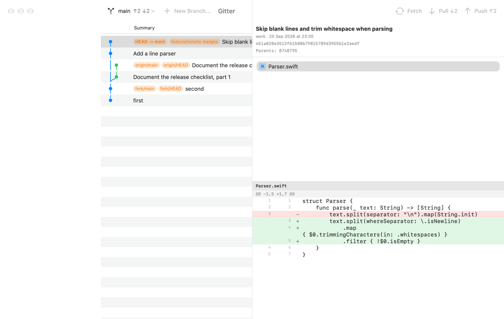
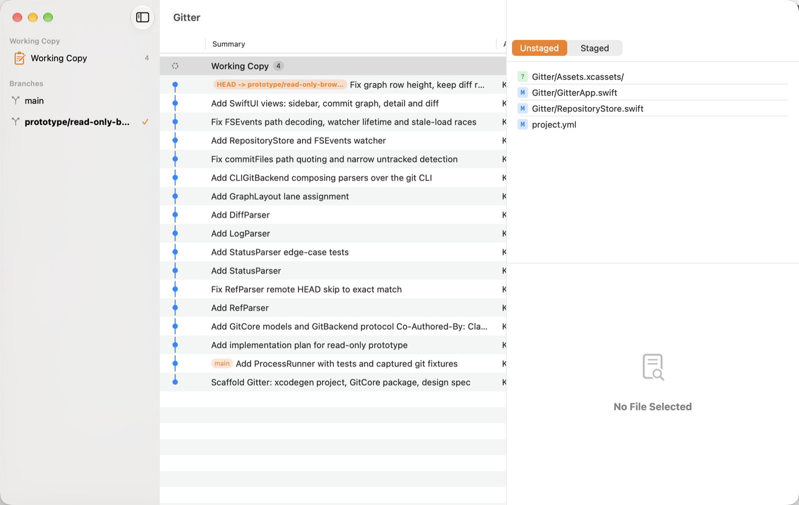
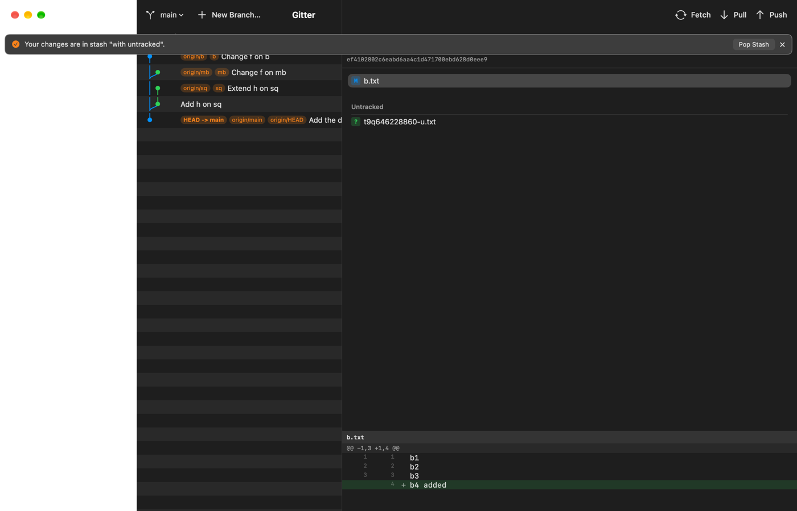
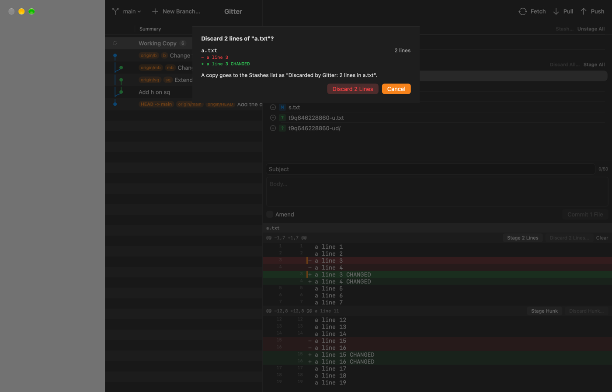
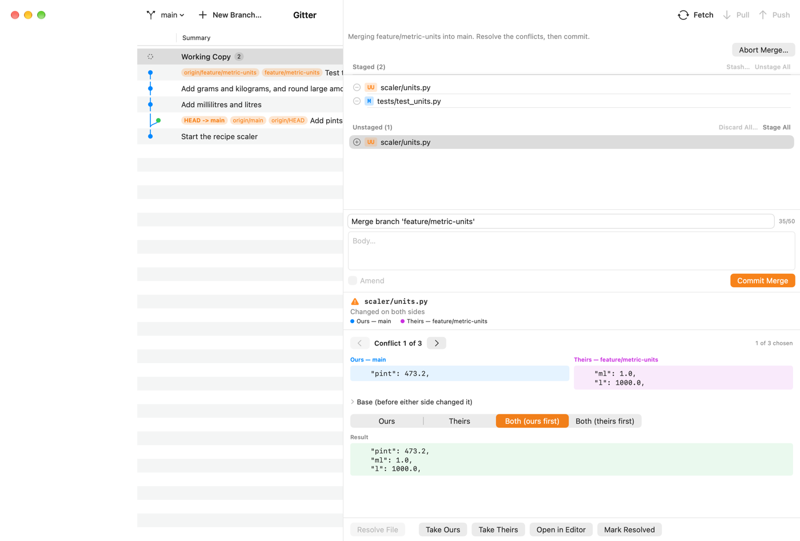
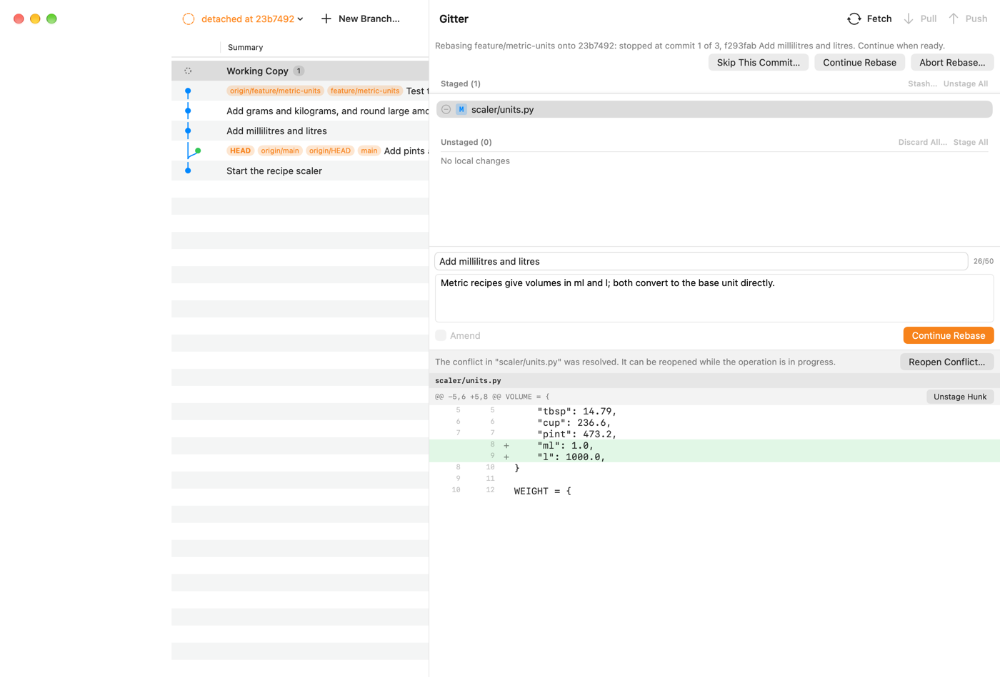
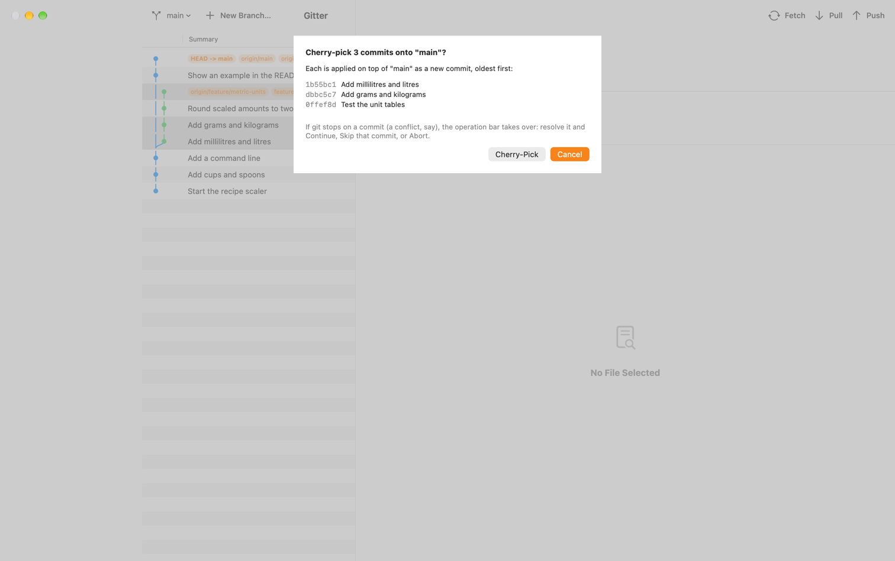
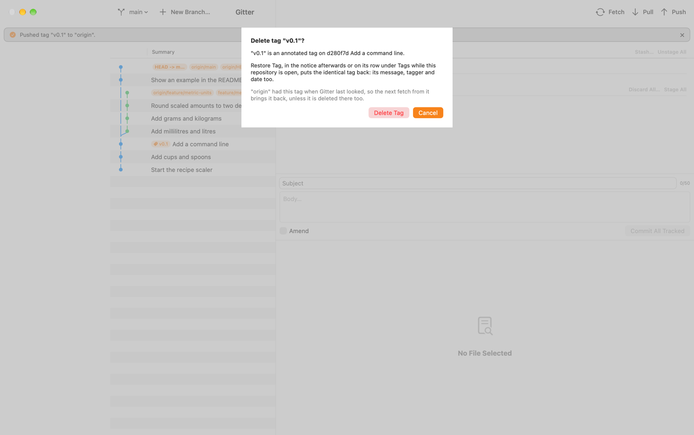
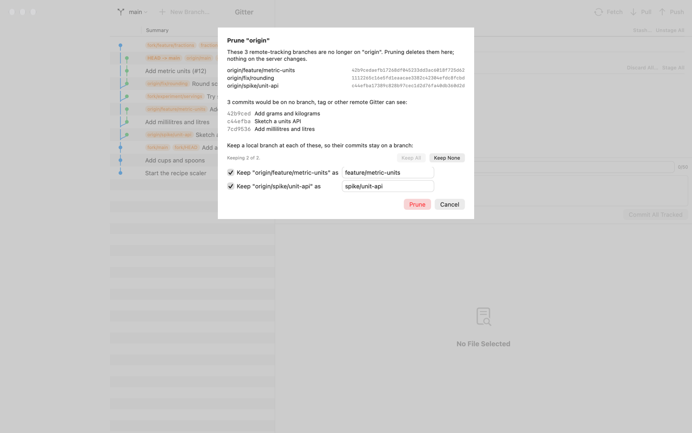
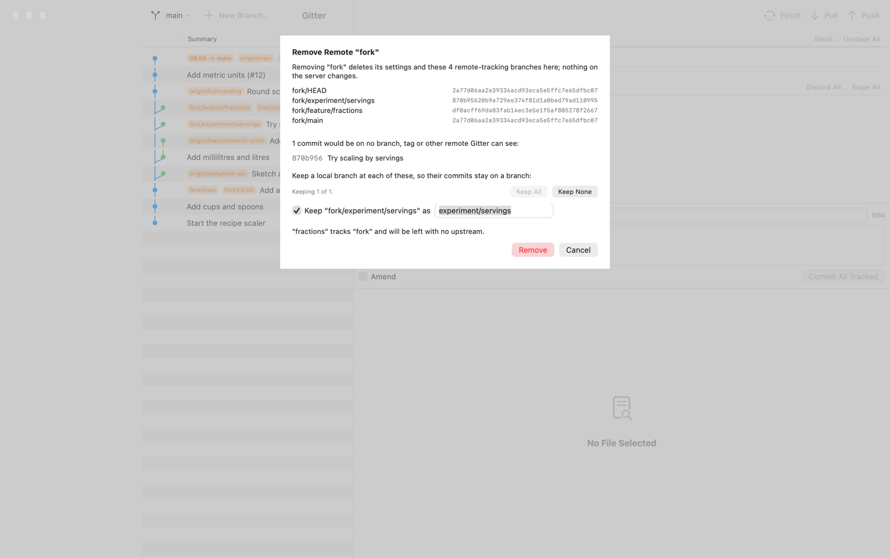

# Gitter user guide

Everything Gitter does, and how it keeps your work safe. The short version is in the [README](../README.md); building, testing and the code's layout are in [DEVELOPMENT.md](DEVELOPMENT.md).

## What it can do

- Browse commit history with a lane graph (gitk-style), all the way to the first commit: older
  commits load as you scroll
- View diffs of a commit, or of the working copy, with wrapping long lines
- Stage and unstage whole files, individual hunks, or a hand-picked set of lines
- Commit, amend the last commit, or commit every tracked change in one step
- Create, switch, rename and delete local branches; check out a remote branch as a local
  tracking branch; check out a commit or a tag (detached HEAD)
- Merge, choosing each time between fast-forward if possible, always a merge commit, and
  squash — the last choice is remembered
- **Resolve conflicts** in the app: each conflict as blocks, ours beside theirs (the base on
  request), with Ours, Theirs, Both (ours first) or Both (theirs first) per block and the result
  shown before anything is written; whole-file choices for what git cannot draw blocks for
  (binary files, symlinks, a mode change, deletions); Open in Editor and **Mark Resolved**; and
  **Reopen Conflict…** while the operation is still going (see "Conflicts" below)
- **Continue** a stopped rebase, cherry-pick or revert from the operation bar ("Rebasing feature
  onto 5e248b9: stopped at commit 1 of 3 …"), with the stopped commit's message in the composer
  to keep or edit, or **Skip This Commit…**; commit a merge or a squash with git's prepared
  message; or end any of them: abort a merge, cherry-pick, revert, rebase or `git am`, and undo
  a pending squash
- **Cherry-pick** or **revert** one or several selected commits (⌘-click, ⇧-click) as one git
  sequence, in the order git needs — the sheet lists them, and the ones left out or likely skipped
  as already applied; **rebase** the current branch onto a commit or a branch, with the commits it
  replays, the merges it flattens and a warning when some are already pushed (see "History actions
  and tags" below)
- **Tags**: create one, annotated or lightweight, on any commit; delete it behind a confirmation,
  with **Restore Tag** afterwards; push one tag to a remote, or delete one there, leased on the id
  the sheet showed; tag pills on the commit rows and a tooltip with the tagger, date and message
- Hooks and commit signing apply as configured, because every commit runs through
  your own `git`, not a reimplementation of it
- Fetch, Pull and Push from the toolbar (Repository menu: ⇧⌘F, ⇧⌘L, ⇧⌘P). The running one
  shows, once it has run for 0.4 s, a spinner, git's own progress line and a Stop button
  (⌘. works from the start); browsing is never
  blocked, and a fetch does not block staging or committing either. In a window narrower than
  1,280 points — the default window, 1,200, is one — the progress line is left out, so the
  running item keeps its Stop and spinner in the toolbar instead of going into the »
  overflow menu; git's words are then the spinner's tooltip (and what VoiceOver reads). The
  item changes only when you resize the window across that width, never when a fetch starts
  or ends. A window that jumps in size while something runs (the zoom button, tiling, a
  display change) from wider than the line needs to narrower than 1,280 can still leave the
  running item in » until it finishes
- Pull fast-forwards when it can and says so in a notice (`Fast-forwarded to
  "origin/main".`); when both sides have moved on it asks, Merge or Rebase, with the counts —
  the last answer is remembered
- Publish a branch that has no upstream (`push -u`), choosing the remote when there is more
  than one (`origin` preselected); Re-publish one whose upstream was deleted on the server
- A hosting service's pull-request link after a push stays on screen, with **Open** and
  **Copy Link**, until you close it, push again or open another repository — the link whole,
  without any user name or token. So does every notice with a button (Pop Stash, Undo Discard)
  or one that holds the only way back: the dropped stash's sha, the `git reset --keep <sha>`
  after a cherry-pick, revert or rebase, the `git branch <name> <tip>` after a force delete or
  after leaving commits behind on a detached HEAD. A success with a warning in it, such as
  "Pushed, but the upstream could not be set", stays too and is drawn with an orange warning
  sign instead of the checkmark, as is a revert left staged. Such a notice never pushes any
  notice with a button or link (Pop Stash, Undo Discard, Restore Tag, a pull-request link's Open
  and Copy Link) off the screen: with one of those up it shows in the fading place instead (the log keeps every notice). Every other notice
  fades after four seconds
- When the server refuses a push because it has commits you don't, the banner offers
  **Pull** and **Force Push…**; the force push is leased on the exact sha it showed you
- Delete a branch on a remote from the sidebar ("Delete on "origin"…"), with a warning that
  says whether its commits are held anywhere else
- Ahead/behind badges on the branch button and the sidebar's branches: `↑2 ↓3`, "gone" when
  the upstream was deleted, and `↑1 · main` when the upstream is a local branch; the Pull and
  Push buttons carry the same counts
- Copy a remote's URL from its sidebar menu, with any password or token taken out
- **Prune** a remote (Remotes ▸ Prune "origin"…, or the remote's sidebar menu): the sheet lists
  every remote-tracking branch the server no longer has with its full id, the commits only they
  hold — counted once — and a ticked "Keep … as" branch for each ref that alone holds some (Keep
  All / Keep None); **Clean Up Gone Branches…** then deletes the local branches whose upstream is
  gone, the merged ones ticked, the others with the unmerged warning (see "Remotes housekeeping"
  below)
- **Push** or **Fast-Forward** a branch that is not checked out, from its sidebar menu — never
  forced, and a fast-forward only when the branch has nothing of its own and no worktree uses it;
  **Set Upstream…**, **Change Upstream…** and **Unset Upstream** on any local branch
- **Add Remote…**, and **Edit URL…**, **Rename…** and **Remove…** on a remote's row: the URL as
  configured, a credential never shown, an `insteadOf` rewrite as a line beside it; the removal
  sheet lists every ref it deletes with its id, the commits it would strand (keepable), and the
  branches left with no upstream or pushing elsewhere. A remote with no URL is in the sidebar,
  marked "no URL", and nothing talks to it until it has one
- **Stash** every change or only the selected files, with a message and, if you ask, untracked
  files too (Repository ▸ Stash Changes…, ⌥⌘S, or **Stash…** in the working copy). The sidebar's
  **Stashes** section lists them; selecting one shows its files and diff read-only, untracked
  files under their own heading. Apply, Pop, and Drop Stash… behind a confirmation, from the
  row's menu. A stash with a message you wrote is named by it; one git named, made with an empty
  message, is named the way git wrote it, `WIP on main: 2153ff9 root`, in its row, its detail
  and every sentence about it
- **Discard** unstaged changes by file, hunk or line, a staged file back to the last commit, or
  an untracked file into the Trash — always behind a sheet that says what goes and where the
  copy is kept, and always with **Undo Discard** afterwards (see below)
- **Stash and Continue**: a switch, merge or pull refused because of your local changes offers
  to stash them and run the same action again (a pull keeps your Merge or Rebase answer and
  does not fetch again); the stash is then offered back (**Pop Stash**), never popped by itself
- Fetch quietly in the background: when a repository opens and every 10 minutes after,
  unless **Repository ▸ Fetch Automatically** is unticked (on by default). It never shows a
  banner — a failure is only a small mark on the Fetch button, with the reason in its
  tooltip — and it never stands in your way: Fetch, Pull and Push stay available while it
  runs, and using one stops it (yours starts once the stopped fetch's git has gone — at once
  for a transport that honours the stop, about 2 s for one that ignores it)
- **Filter** the sidebar (⌘F): branches, remote branches and tags narrowed as you type, every
  word matching, case and accents ignored (see "Navigation" below)
- **Compare two branches**: "Compare with "main"" on any branch, or Compare Branches… — the
  commits only on each side with exact counts, and the changes one side brings, exactly as `git
  diff A...B` shows them
- **Worktrees**: a sidebar section with each worktree's branch, changes, lock and missing folder;
  branches checked out elsewhere marked; **Open Worktree**, **Add Worktree…** and **Remove
  Worktree…** (behind Gitter's own check of what git would delete), **Remove All Missing…**
- Quit safely while the network is busy: a fetch or pull is stopped and Gitter quits; a push
  (or publish, force push, delete on a remote) asks first — **Wait** lets it finish and then
  quits (or stays open if it failed or has a warning, so you can read it, or if it is still
  running after ten minutes), **Stop and Quit**, or **Don't Quit**

The pictures below, and the compare and worktree ones further down, were taken before the window
became two columns (2026-10-11): what each shows is current, but around it the window is the old
one, three columns with the commit list's divider running up through the toolbar. The picture at
the top is the window as it is now; the rest are on the backlog to retake.

## Safety

Staging and unstaging change only the index (`git apply --cached`, `git add`, `git reset`)
and committing writes only to the repository. Branch operations change the working tree,
since that is what a checkout is; remote operations change another machine; and stash and
discard take changes out of your files, which is their whole point. So the promise is
restated rather than dropped — in the design's words:

> **Gitter never discards uncommitted work or commits without a confirmation that names
> what will be lost** — and a discard also leaves a copy that can be brought back.

Switch, detach, track and merge run plain git with **no force flag anywhere in the code**
(`--force`, `-f`, `--discard-changes`, `-B`, `-C`, `--merge` on switch are forbidden, and
a test greps the sources for them on every run). When git refuses, nothing has changed,
and Gitter shows the files git named rather than a wall of stderr. The same test forbids,
for the network: a bare `--force-with-lease`, any refspec beginning with `+`, `--mirror`,
`--prune` (except in the prune sheet's listing, a `fetch --dry-run` that deletes nothing), `--all`
on push, `--tags` and `--follow-tags`, `--delete`/`-d` on push,
`--no-verify`, `--autostash`, `--update-refs` on rebase, and the `pull` subcommand itself
(Gitter fetches and then merges or rebases as two steps it controls). For the working copy
it allows `stash` only in five exact spellings — never with a pathspec, `--keep-index`,
`--staged`, `--all` or `-p`, and never `pop`, `clear`, `create`, `branch`, `show` or
`apply --index` — `restore` only with `--no-recurse-submodules`, and forbids `clean`,
`checkout`, `hash-object` and `--unidiff-zero` everywhere; `read-tree`, `update-index` and
`write-tree` may appear in one file only, the one that builds a discard's record in a
temporary index. For conflicts it allows `merge-file` only with `--object-id` (without it git
writes over its first argument), `restore --ours|--theirs|--merge` and `rm -q` only on one
path at a time, and `--skip` only as exactly `rebase --skip`, `cherry-pick --skip` or `revert
--skip`; `--quit` stays forbidden. For worktrees it allows only `worktree list --porcelain -z`,
`worktree add -q --end-of-options <path> <branch>` and `worktree remove --end-of-options <path>` —
never `prune`, `move`, `repair`, `lock`, `unlock`, `-f`, `-b`, `-B`, `--orphan` or `--detach` — and
no 3-dot range ever reaches `diff-tree`. A list of paths for `add`, `restore` or `rm --cached` goes
in a pathspec file rather than one argument per path: past 4 096 arguments macOS's `Process` does
not fail, it crashes the app, so every call is also checked before git starts. (Stage All still
passes its paths as arguments, `add -- <paths>` in batches of at most 1 000; only the writes of a
selection use the pathspec file.)

Sixteen actions can lose something without being asked for by name, and each is behind a
confirmation that says what goes and what stays:

| action | how it is confirmed |
|---|---|
| Abort a merge, cherry-pick, revert, rebase or `git am` | a sheet with that operation's own kept/lost wording — a rebase abort also takes unstaged edits, `am --abort` rewinds the branch past the patches it committed, a cherry-pick or revert range's abort past the commits it already made (named) — and **the exact list of files** it is about to put back, read live |
| Undo a pending squash | the same sheet: everything staged goes, including work staged before the squash if the squash was started outside Gitter, which is why the file list is not optional |
| Force-delete an unmerged branch | `git branch -d` runs first and either deletes or refuses *without changing anything*; only its refusal opens a warning naming the unique-commit count and the tip sha, and "Delete Anyway" is refused unless the branch still points at exactly that tip |
| Leave a detached HEAD holding commits on no branch, tag or remote | a warning naming the count and the full sha, with "Create Branch Here…" as the safe answer; leaving anyway prints the command that brings the commits back |
| **Force push** — only ever offered from a push the server refused because it has commits you don't | Gitter fetches, then a sheet names the remote and branch, shows **both shas in full** — the remote tip that will be replaced and your local tip that will be pushed — and lists the commits that will leave the server's branch, with their authors. On "Force Push" it re-reads your branch and refuses if it has moved since the warning; the push then carries `--force-with-lease=<remote ref>:<the remote sha shown>` and sends `<the local sha shown>:<remote ref>`, so what the server loses and what it gets are exactly what the sheet showed. If the server's branch moved meanwhile, git itself refuses (`stale info`) and nothing on the server changes |
| **Delete a branch on a remote** (sidebar ▸ remote branch ▸ "Delete on "origin"…") | Gitter fetches that remote, then a sheet names the branch, the remote and its tip in full, and says whether its commits are **held by no branch, tag or other remote Gitter can see** (and how many). The deletion is leased on that tip (`--force-with-lease=refs/heads/<b>:<tip>` with `:refs/heads/<b>`), so a branch that moved, or is already gone, is refused by the server and nothing is deleted. The notice afterwards prints the `git push <remote> <tip>:refs/heads/<b>` that recreates it |
| **Discard** — a file's unstaged changes, its staged and unstaged changes, a hunk, some lines, an untracked file, or Discard All | a sheet names every file with what it loses (`+12 −3`, `2 lines` with the lines themselves, `untracked → Trash`) and says where the copy goes. On confirm Gitter reads everything again and refuses if anything changed since the sheet was shown; then it **records** the tracked changes in the Stashes list before it touches a file, and moves untracked ones to the Trash (see "Stash and discard" below) |
| **Drop a stash** | a sheet names the stash's message, its files and its full sha, with a live warning if the list moves while it is up; the drop is refused unless the entry at that position is still that sha. The notice afterwards prints the `git stash apply <sha>` that brings it back until git's cleanup removes it |
| **Skip a commit** of a stopped rebase, cherry-pick or revert | a sheet names the commit and every file that goes back to how HEAD has it, resolved or not; Gitter first files their current contents in the Stashes list as `Skipped by Gitter: <sha> <subject>`, and skips only when every change in the working copy belongs to that commit — git's own `rebase --skip` resets every tracked file, your unrelated edits included |
| **Leave a commit out of a rebase** — Continue when the resolution leaves the stopped commit with no changes | "Leave d183fcd out of the rebase?": git would drop it without a word. When other files are staged the sheet says the opposite happens — the commit is kept, holding only them, under its own title and author |
| **Replace a hand-edited conflicted file** — Resolve File, Take Ours or Theirs, Delete or Keep on a file edited since git wrote the conflict | the sheet says the file changed since git wrote the conflict; the edited file is filed as `Replaced by Gitter: <file>` before anything is written |
| **Prune a remote** | Gitter asks the server which of the remote's branches it no longer has (a dry run that deletes nothing), then a sheet lists each remote-tracking branch with **its full id**, the commits that would be on no branch, tag or other remote afterwards — **counted once for all of them** — and a ticked "Keep … as <name>" for each ref that alone holds some. On Prune it counts again and refuses if more would be stranded, creates the kept branches first, then deletes each ref **only while it still holds the id the sheet showed** (`update-ref -d` with that id); one that moved is left alone and named. The notice lists every deleted ref with its id — a remote-tracking ref has no reflog to find it by |
| **Clean Up Gone Branches** | a sheet lists the local branches whose upstream is gone, each "merged" or "N commits only here"; merged ones are ticked, an unmerged one carries the unmerged-branch warning when ticked, and a branch checked out in a worktree cannot be ticked. Each is deleted only at the tip the sheet showed, after a recount; the notice lists every tip with `git branch <name> <id>` |
| **Remove a remote** | a sheet lists every remote-tracking ref git will delete with its full id, the commits that would be stranded (keepable, as for a prune), the branches that will have no upstream and the ones whose push silently goes to another remote. On Remove it reads all of that again and refuses on any difference; the notice is the only record of the deleted refs, each with its id and the `git update-ref` that brings it back |
| **Remove a worktree** (and **Remove All Missing…**) | Gitter checks first, off the main thread, everything git's own `worktree remove` would delete without asking — ignored files and folders (listed, with the count), assume-unchanged and skip-worktree edits, a repository nested anywhere in it, untracked files hidden by `status.showUntrackedFiles=no`, an operation in progress, refs that live only in that worktree (`refs/worktree/…`, a bisect's) and the commits only they hold — and refuses on any of them, or on changes, a lock or an unreadable folder, with the reason in place of the button. A detached worktree's own commits are listed with a ticked "Keep … as" branch. On Remove it makes the whole check again and refuses if anything differs — every ignored entry, not just their number — creates the kept branches, then runs git with those settings forced back. "The branch <b> stays" is said, and a half-done removal is read back and worded |
| **Reopen a resolved conflict** | the sheet says what comes back — conflict markers; for a binary file ours' version, with no markers; for a mode conflict ours' mode — and the resolution is filed as `Reopened by Gitter: <file>` first |

Three more confirmations stand before a commit rather than a loss: **Mark Resolved** when git
still finds conflict markers in the file, **Continue** when files that are not part of the
stopped commit are staged (git commits everything staged into it, under that commit's title),
and **Stage All** during an operation when it would add files outside it — named from the very
list Stage All stages, untracked files included even when `status.showUntrackedFiles=no` hides
them from the file list, and nothing is staged if that list changed after you agreed. In the force push,
delete-on-remote, discard, drop, conflict and continue sheets Cancel holds Return and the
destructive button has no shortcut. A force push's sha is
spelled out rather than left to git on purpose: a bare `--force-with-lease` leases against
the remote-tracking ref, which Gitter's own automatic fetch rewrites — measured, in the
situation where the explicit lease answers `stale info`, the bare one force-pushed and took
a colleague's newest commit off the branch.

Pull with **Rebase** rewrites your local commits, and it is asked for by name: the pull
sheet says how many commits it rewrites, that it needs a clean working copy, and that a
merge commit among them is flattened rather than kept. It is never a default you did not
choose; the old tip stays in `ORIG_HEAD` and the reflog. A rebase that stops on a conflict
lands in the operation bar: resolve there and Continue, Skip the commit, or Abort, which puts
everything back.

Amending is the one more — sixteen confirmed actions, plus amend — and the one with no
confirmation sheet: it rewrites HEAD and leaves
the commit it replaces reachable from no branch, tag or remote. What stands in for the sheet
is that nothing else asks for it — you tick the Amend toggle yourself and the commit button
then reads "Amend Commit" — plus a warning, "Amending rewrites history that has already been
pushed.", when the branch tracks an upstream and has nothing ahead of it, which is exactly
when the commit being rewritten has already been pushed. And the replaced commit is still in
the reflog, as `HEAD@{1}`.

Amending is unavailable while any of those operations is in progress, and that is not
belt-and-braces: git refuses `git commit --amend` during a merge and a cherry-pick and
**accepts** it during a revert, a rebase, a `git am` and a pending squash (measured on git
2.54). Each of those four rewrites the commit the operation was standing on, leaving it
reachable from no branch, tag or remote, with nothing on screen to say so — the same kind of
loss the table above confirms, and one nobody would have been asked about. So Gitter refuses
all six itself, before git runs, and the Amend toggle says which operation is in the way.

A network write that is stopped or fails is **never reported as "nothing changed"**: a
stopped push says the remote "may or may not have been updated" and fetches to find out.
A stopped or failed fetch leaves the repository intact (no `*.lock`, `git fsck` clean).

The staging claim is verified by tests that read **every byte of every worktree file** before
and after each staging operation and require them to be identical (`worktreeSnapshot` keeps
the file contents, not a digest, so a failure can print what changed); every branch refusal is
tested the same way, with the index, HEAD and every ref compared as well, and every remote
refusal also compares every ref of the bare "server" repository.

### Credentials: whatever git already has

Gitter never sees, asks for or stores a secret. Every fetch, pull and push is your own
`git`, so your credential helper (the macOS Keychain helper included), your ssh-agent, your
`~/.ssh/config` and macOS ssh's Keychain passphrases (`UseKeychain`) all apply as they do in
a terminal. git is run with `GIT_TERMINAL_PROMPT=0`, so when it would have had to ask for
something it fails at once, and Gitter says what to do **once, in a terminal**:

- HTTPS with no stored login — "<url> needs a login that git doesn't have. Run git fetch once
  in a terminal to sign in; Gitter will use it afterwards." Run `git fetch` in that
  repository, sign in when git asks, and the credential helper remembers it.
- A key the server refused, or one git could not unlock — "<url> refused the login git
  offered. Run git fetch in a terminal to sign in again."
- An unknown ssh host key — "The server's host key isn't trusted yet. Connect once from a
  terminal (git fetch) to check its fingerprint and accept it."

**A passphrase-protected ssh key.** When the environment sets neither `SSH_ASKPASS` nor
`SSH_ASKPASS_REQUIRE`, Gitter starts its network git with `SSH_ASKPASS_REQUIRE=force`. A Mac
has no askpass program, so ssh can never ask for a passphrase or a host key — it fails in
about 50 ms with the real cause, however Gitter was launched. Before this, a Gitter launched
**from a terminal** had ssh stopped by the terminal (SIGTTOU) as it went to ask, before any
prompt was shown: the automatic fetch then hung until its 2-minute timeout, and a manual one
until Stop. Now it fails like any other refused key: load the key into your agent (`ssh-add`)
or let macOS keep its passphrase (`UseKeychain`), and Gitter uses it from then on. Your own
`SSH_ASKPASS`, `SSH_ASKPASS_REQUIRE`, `GIT_SSH_COMMAND` and `core.sshCommand` are never
touched; if you set `SSH_ASKPASS` without `SSH_ASKPASS_REQUIRE` and start Gitter from a
terminal, ssh's own rules apply and it can still be stopped there (see the backlog).

### What fetch and push deliberately do not do

- **No prune on fetch.** Gitter's fetch, manual or automatic, always passes `--no-prune`, even
  when `fetch.prune`, `remote.<name>.prune` or `fetch.pruneTags` is set: pruning can drop the
  last ref to a deleted branch's commits, so it has a confirmation of its own — **Prune
  "origin"…** (see "Remotes housekeeping"). Until you prune, a branch someone deleted on the
  server keeps its `origin/…` ref, and its local branch keeps counting against it; the **"gone"**
  badge appears after a prune — Gitter's or a terminal's — or after Gitter's own "Delete on …",
  which removes the one ref it deleted. A "gone" branch's Push button reads **Re-publish**.
- **No tags.** Every push passes `--no-follow-tags`, even when `push.followTags` is set,
  including a force push and a deletion — measured, git otherwise publishes annotated tags
  beside the one ref it was asked to push, even beside a delete.
- **One branch at a time** — the current one from the toolbar, another from its sidebar menu
  (**Push "b"**) — always by an explicit refspec (`refs/heads/<b>:<remote ref>`), to that
  branch's push remote (`branch.<b>.pushRemote` / `remote.pushDefault` are honoured).
  The force push is the one exception to the spelling, not to the rule: it sends the sha its
  sheet showed (`<sha>:<remote ref>`), so what lands is the commit you were shown even if the
  branch moved meanwhile — and if it did, Gitter refuses instead.
- **No submodules.** Every push passes `--no-recurse-submodules`: with `submodule.recurse` or
  `push.recurseSubmodules=on-demand` set, git otherwise pushes the submodule's branch to the
  submodule's own server too. (This also overrides `push.recurseSubmodules=check`.)
- **No autostash.** Pull's fast-forward and merge pass `--no-autostash`: with
  `merge.autoStash` set, git otherwise stashes an edit the pull would overwrite, reports
  success, and leaves the file with conflict markers. Gitter shows git's refusal instead.
- **No fetch into your own branches.** A fetch is only a read of the server while the remote's
  fetch refspecs write into `refs/remotes/`. One that writes anywhere else
  (`+refs/heads/*:refs/heads/*`, a `--mirror=fetch` remote) would move your local branches or
  tags on every fetch, so Gitter does not fetch that remote — it says so, with the `git
  config` line that fixes it — and fetches the others.

### Stash and discard: where your changes go

**Stash.** "All changes" is git's own `git stash push` (with `--include-untracked` when you
tick it). "Selected files" is not: a stash with a pathspec takes every staged file with it, so
Gitter builds the entry itself from exactly the files you picked, in a temporary index that
never touches yours, files it as an ordinary stash entry, and only then restores those files;
a selected untracked file goes into the entry first and then to the Trash. Apply never puts
back a stash's staged layer — git's `--index` would unstage your other staged files and can
lose a staged version — so everything comes back unstaged (a new file comes back staged). **Pop
drops the entry only after a clean apply**, and only if it is still the entry you picked: if
the list changed in between, the notice says it was applied but not dropped, and the entry
stays. A conflicting or refused apply keeps the entry. The one thing a stash does not keep is
an empty untracked folder, which git deletes; the sheet says so.

**Discard.** Tracked changes are **recorded first**: before any file is touched, Gitter files
a stash entry named `Discarded by Gitter: <files>` (or `Discarded by Gitter: 2 lines in
<file>`) holding exactly the discarded files as they were, both layers — so even a crash in
the middle leaves at worst an extra entry. Then git does the discarding: `git restore` puts the
unstaged side back to what is staged, or the staged side back to the last commit (index and
disk), and a hunk or line discard reverse-applies just those lines. **Untracked files and
folders go to the macOS Trash**, never deleted (a folder goes whole, ignored files in it too).
The sheet is a snapshot: on confirm everything it showed is read again, and if anything
changed — a file edited in your editor meanwhile — nothing is discarded.

**Undo Discard.** The notice after a discard stays until you close it, and its **Undo
Discard** puts things back:

- a file's unstaged changes: the record is applied again and then dropped;
- staged and unstaged changes: the same, then the staged part is staged again — unless a
  commit was made, or something about that file was staged, since; then the changes come back
  unstaged, and the notice says why;
- some lines: the same lines go back, but only onto the file exactly as the discard left it
  (its bytes, its staged version and HEAD) — anywhere else they could land in the wrong place;
- untracked items: each one comes back from the Trash; one whose name is taken again stays in
  the Trash, and nothing is overwritten.

Undo is refused rather than forced whenever a file changed since the discard, and the record is
dropped only when the file is back byte for byte. Whatever Undo cannot do, the copy is still
there: the `Discarded by Gitter` entry in the Stashes list (Apply it; a line discard's entry
holds the whole file, so stage that file's other changes first), and Finder's **Put Back** for
anything in the Trash. Applying or popping that entry yourself ends the notice's Undo.

Line and hunk discard are offered only where a patch can take exactly those lines: not for a
binary, renamed or non-UTF-8 file, a change that covers the whole file, or a file whose line
endings are not the ones a checkout writes (under `core.autocrlf`, git would rewrite every
line). There the hunk offers **Discard File…** instead. Nothing is stashed during a merge,
rebase, cherry-pick, revert, `git am` or pending squash (git's own stash silently ends some of
them), nor applied, popped or dropped while a file is still conflicted. Discard works during
one, except for a conflicted file (resolve it instead) and the staged side of a file the
operation itself changed — its commit would lose that change; a whole-file discard's **Undo**
then waits until the operation has ended (its `stash apply` would disturb it), and the copy
stays in the Stashes list meanwhile. Nothing is discarded for an intent-to-add (`git add -N`),
submodule or nested-repository path, nor where a file and a folder swapped places; tracked
files cannot be discarded before the first commit, since the record needs one.

### Stash and Continue

When a switch, a checkout, a merge (a squash too) or a pull is refused because of your local
changes, the error banner offers **Stash and Continue**. It stashes every change — untracked
files too when git named one in the way — as `Gitter: before switching to b`, `Gitter: before
merging b` or `Gitter: before pulling`, then runs the same action again from the start. A pull
does not fetch again — its fetch had already worked; only the merge or rebase was refused — so
the retry needs no network and a Fetch you start meanwhile does not stand in its way. It decides
again from what the stash's reload read: still diverged from the same upstream, on the same
branch, it runs the Merge or Rebase you had answered without asking again; a fast-forward now, or
nothing to do, it does what a fresh pull would; on another branch or another upstream it asks.
A fast-forward checks once more, just before it merges, that your branch has nothing the upstream
lacks; if a fetch moved the upstream meanwhile, nothing is merged and the banner says to pull
again and choose Merge or Rebase (the first pull's fast-forward checks the same). A notice,
`Your changes are in stash "Gitter: before pulling".`, stays with a
**Pop Stash** button, which pops that entry wherever it has moved in the list. Nothing is
popped by itself: if the retried merge conflicts, your changes wait in the stash. If there was
nothing a stash could hold, or the stash failed, the action is not run again and the banner
says why.

### Conflicts: resolve, continue, skip

**The chooser.** Select a conflicted file — its row shows git's letters, `UU`, `DU` and so on,
with the kind in words as the tooltip — and the resolver takes the diff's place. Its blocks are
rebuilt from the three versions git keeps in the index (`git merge-file`), never parsed out of
the file, so a line of your code that looks like a marker stays code. Each block shows ours
beside theirs, the base behind a disclosure, and four choices: **Ours**, **Theirs**, **Both
(ours first)**, **Both (theirs first)**, with the result under it. Nothing is written while you
choose; **Resolve File**, once every block has a choice, writes the file in the form git would
have — line endings, filters, the executable bit, a missing final newline — and stages it. The
sides are named: in a merge the branch you are on and the one merged; in a rebase **upstream**
is ours and **your commit** theirs (git's own sides, the other way round from what the words
suggest); in a cherry-pick or revert the commit being applied or undone.

**Whole files.** Where git draws no blocks — a binary file, a symlink, a mode change, a merge
driver of yours, a file one side deleted — the resolver says why and offers that kind's own
choices: **Take Ours** / **Take Theirs**, or for a deletion **Delete the File** and **Keep Their
Version** (we deleted it, they changed it) or **Keep Our Version** (the other way round). A side that has no version is not offered (git would delete the file and say
nothing). A submodule conflict is shown and explained, not resolved here.

**A conflict Gitter cannot read.** If reading a conflicted file's versions fails, the resolver
says so instead of spinning: "Gitter couldn't read this conflict: <git's words>. You can still
open the file in its editor, or mark it resolved as it is.", with **Open in Editor**, **Mark
Resolved** (its usual check and sheet; not for a file both sides deleted) and **Try Again**,
which reads it again. A read that works, or selecting another file, ends it.

**Your own edits.** **Open in Editor** opens the file; resolve it there, then **Mark Resolved**
stages it as it is — and asks first when git still finds conflict markers in it, as do the
row's stage button, Space and a double-click. A file you edited since git wrote the conflict
shows as "changed since the conflict", without the chooser, and any choice that would replace
it asks first and files it in the Stashes list. Every write checks that the file and its index
entries are still what was on screen; if not, nothing is written and the banner says so.

**Reopen Conflict…** (in a resolved file's staged-row menu, and above its diff) brings the
conflict back while the operation is still in progress: the markers again — or, as the sheet
says, ours' version of a binary file, ours' mode for a mode conflict — with the resolution filed
first. It is not offered once the operation has ended, for a file resolved by deleting it, or
for a symlink.

**Continue and Skip.** The operation bar says where the operation stopped and what comes next;
**Continue** is off until every file is resolved, with the reason as its tooltip and on a line
under the sentence. The composer holds the stopped commit's message without git's comment
lines: leave it and git's own message goes through unchanged, with the original author and date
(a revert is yours); edit it and yours is used. A message edited for another commit, or typed
before the operation stopped, is flagged first: use the stopped commit's message, or keep
yours. Continue asks first when other files are staged (git would put them into this commit)
and, in a rebase, when the resolution leaves the commit with no changes (git would leave it
out). A cherry-pick or revert of several commits stays blocked while a tracked file has
unstaged changes, because git would make this commit and then stop the range half-way.
**Skip This Commit…** is offered only when every change belongs to the stopped commit, and
files those changes first. A merge or squash ends with **Commit**, prefilled with git's message.
**Abort…** asks as before, and when a cherry-pick or revert of several commits has already
made some of them (you continued past a stop, then it stopped again), the sheet names those
commits: git's `--abort` takes the branch back to where the range began, so they leave the
branch and stay only in git's reflog for a while.

**Where the copies go.** Each is an ordinary entry in the Stashes list:

| entry | made by | holds |
|---|---|---|
| `Replaced by Gitter: <file>` | Resolve File, Take, Delete or Keep over a file edited since the conflict | the edited file |
| `Reopened by Gitter: <file>` | Reopen Conflict… | the resolution, staged and on disk |
| `Skipped by Gitter: <sha> <subject>` | Skip This Commit… | the skipped commit's files as they were, half-resolved ones included |
| `Discarded by Gitter: …` | a discard during the operation | as in "Stash and discard" above |

The notice after each offers **Show Copy**, which selects the entry. Applying or popping a
stash is refused while an operation is in progress or a file is conflicted, so an entry comes
back once the operation is over — the notice after a Skip that finished it offers **Pop Stash**
straight away.

**What stays a terminal job.** `git am --continue` and `--skip` (Gitter only aborts an `am`), a
submodule conflict, reopening a file resolved by deleting it, unstaging a whole file while an
operation is in progress (the row's "−" and Unstage All stay off throughout: they can end the
operation or collapse a conflict; a modified text file can still be unstaged hunk by hunk or
line by line, an added file not as a whole), and `--quit`. When a cherry-pick or revert range stops part-way with no operation
left — git made or skipped one commit, then refused the next — a bar lists the commits git did
not apply and the commands, with full shas, that apply them (**Copy Command**), and warns that
`--continue` would leave the first one out. A cherry-pick started over such a leftover list is
not continued, skipped or aborted by Gitter at all — git's `--continue` would resume the old
list and its `--abort` rewind past it — and the bar gives the safe way out instead. A range
commit you concluded with `git commit` in a terminal shows as waiting, with the `git
cherry-pick --continue` that applies the rest.

### History actions and tags

**Cherry-pick and revert.** Select one or several commits in the list (⌘-click, ⇧-click — the
detail pane shows the first, under "3 commits selected. Showing the first.") and right-click:
**Cherry-Pick 3 Commits…** or **Revert 3 Commits…**. The sheet lists the commits in the order git
will get them — a cherry-pick oldest first by the graph, never by date (a skewed clock would get
that wrong), a revert newest first — and runs them as one git sequence. Commits the branch already
contains are left out and named; a commit whose change the branch already has as an identical
patch "may be skipped as already applied", and the notice afterwards names the ones git skipped.
A merge commit is refused with the reason (there is no mainline picker), and so is a revert of a
commit the branch does not contain. When git stops on a conflict, the operation bar of "Conflicts:
resolve, continue, skip" takes over. A revert's message is always git's own `Revert "<subject>"`
(or `Reapply "<subject>"` for a revert of a revert), whatever `revert.reference` says — for the
commits still to go after a stop too, when Gitter's Continue or Skip goes on (git does not keep
that choice in the sequence), and so also for a revert range started in a terminal and continued
in Gitter. The commit git stopped on keeps the message git wrote for it.

**Rebase onto a commit or a branch.** **Rebase "main" onto Here…** on a commit row, **Rebase
"main" onto "feature"…** on a branch or remote branch. The sheet lists the commits that will be
replayed, oldest first — or says that nothing is rewritten ("already contains", "moves straight
forward") — and how many merge commits are flattened into a line (always: `--no-rebase-merges`,
whatever `rebase.rebaseMerges` says), how many are skipped because the target already has them,
and, in orange, how many are already on a remote (pushing afterwards then needs a force push).
The target goes to git as a full commit id, so a tag named like the branch cannot redirect it.

**Before any of them runs.** All three are refused while an operation is in progress or any
tracked file has changes, staged or not (untracked files are fine): a sequence that starts clean
cannot halt half-way on a tracked change of yours. An untracked file that a later commit adds can
still halt it, and the halted bar then lists what is left. The banner offers **Stash and
Continue**, which stashes and then asks again — the sheet comes back; nothing runs unasked. The
sheet is a snapshot: if the branch moved, you switched to another branch (even at the same
commit), the target moved or the commits changed while it was open, nothing runs and the banner
says "The branch changed while this was open … Ask again to see what it would do now." A rebase
also refuses when more of its commits are already on a remote than the sheet said (its warning
was then too weak), with "What the rebase would do changed while this was open (the target, the
commits to replay, or how many are already pushed), so nothing was rebased. Ask again to see
what it would do now."; fewer than it said is no reason to refuse. Both banners have an **Ask
Again** button, which plans the action again and puts the sheet back up.

**The way back.** The notice after a cherry-pick or revert says the reflog keeps where the branch
was, with the command: `git reset --keep <full sha>`; after a rebase, that the old tip is
`ORIG_HEAD` for now (the next reset, merge or rebase overwrites it), with the same command. Both
stay until you close them (a rebase that only fast-forwards, or finds nothing to do, rewrites
nothing, and its notice fades). A single revert that git could not commit — a signing failure,
or a `prepare-commit-msg` hook saying no — leaves the revert staged with no operation git can
show; a notice says so in git's words, with the orange warning sign, and stays, and git's revert
message waits in the composer: Commit it, or Discard it.

**Tags.** **New Tag…** on a commit's menu: annotated, with a message stored exactly as typed (`#`
lines and blank lines kept), or lightweight; never signed, whatever `tag.gpgSign` says. The name is
checked as you type, and refused where git would later read it as something else: a branch's or a
remote's name (`main`, `origin`, `origin/x` — git takes the tag first in every command that names
it), git's own names (`HEAD`, `@`, `MERGE_HEAD`, `ORIG_HEAD` and the like, which would make a clean
repository look mid-merge, and `stash`, after which git refuses to drop any stash entry), seven or
more hex digits (an abbreviated commit id), and an existing tag in any case (`V1` beside `v1`; the
file system cannot tell them apart). The sidebar's Tags rows show the kind by their icon and the
tagger, date and message as the tooltip, and the commit list's tag pills come from the tag list
itself, so `log.decorate` settings cannot hide or rename them.

**Delete Tag…** deletes only if the tag still holds what the sheet showed (one compare-and-delete;
otherwise nothing is deleted and the banner says so). The sheet says whether a fetch would bring
it back — a remote this session saw holding this very tag does, a remote set to fetch no tags
does not. Tags have no reflog, so Gitter keeps the way back itself: the notice offers **Restore
Tag** (one **Restore Tags** for several), and once the notice is gone each deleted tag stays as a
dimmed, struck-through row under Tags with Restore Tag in its menu — for as long as the repository
stays open. A restore brings back the identical tag, message, tagger and date included; the
terminal command, `git tag --no-sign <name> <id>`, is in the notice and the row's tooltip.

**Push Tag to "origin"** sends exactly that one tag (`--no-follow-tags`, so `push.followTags`
cannot add others); one already there says so, and when the remote has a different tag of that
name nothing is pushed: Gitter never replaces a tag on a remote. **Delete from "origin"…** reads
the remote's tag, shows its id and whether it is the tag you have here, and deletes it only while
the remote still holds that id (a lease; if it moved meanwhile, nothing is deleted). Your local tag
is kept, and when a tag here holds the same object the notice gives the `git push` command that
puts the remote one back. A plain git server's `receive.denyDeletes` protects branches only, not
tags — only a server hook or a hosting service's tag protection can stop this delete.

**What stays a terminal job.** Interactive rebase (reorder, squash, fixup, drop, reword);
cherry-pick `-x`, `--no-commit` and `-m` (a merge commit); signed tags; pushing all tags at once
(`--tags`); moving a tag (`tag -f`, or replacing one on a remote); and symbolic refs under
`refs/tags/`, which Gitter lists but neither deletes, pushes nor restores — git's own delete would
follow one to the branch it names, and a restore could not bring a symbolic ref back.

### Remotes housekeeping

**Prune "origin"…** — in the Remotes menu, and on the remote's row in the sidebar — asks the server
which of the remote's branches it no longer has. That listing is git's own dry run (`fetch --prune
--no-prune-tags --dry-run --porcelain`): it runs on the network lane like a fetch, with a Stop,
and deletes nothing. Only refs under `refs/remotes/` are listed, so a mirror-style remote is
refused, and `fetch.pruneTags` cannot add your local tags. The sheet shows each ref with its full
id, then the commits that would be on no branch, tag or other remote once they are gone — one
count for all of them, since two refs can share commits — and a "Keep "origin/x" as" box with a
name for each ref that alone holds some, ticked. **Keep All** and **Keep None** set every box, and
"Keeping 2 of 3." says where you are; a name that is taken or not a valid branch name says so as
you type. When `origin/HEAD` points at a ref being pruned the sheet says it will point at nothing
— a later fetch does not repair it. Prune then counts again (refusing if more would be stranded
than the sheet said), creates the kept branches, and deletes each ref only while it still holds
the id the sheet showed: a ref that moved meanwhile — a fetch updated it, say — is left alone and
named. The notice is the only record of what was deleted, so it lists every ref with its id and
the `git update-ref` that brings one back. Gitter's own fetch still never prunes.

**Clean Up Gone Branches…** (Remotes menu) lists the local branches whose upstream is gone — a
remote branch deleted on the server and pruned, or a deleted local upstream. Each row says
"merged" or how many commits exist only on it; merged rows start ticked, an unmerged row shows
the unmerged-branch warning when you tick it, and a branch checked out in any worktree cannot be
ticked. Each ticked branch is deleted only at the tip the sheet showed, after its commits are
counted again; the notice lists every tip with `git branch <name> <id>`. git deletes a branch
even when another process holds `.git/config`, and then leaves its `branch.<name>.*` settings
behind (measured); Gitter reads them back and gives the `git config --remove-section` that
removes them.

**Another branch.** A local branch's menu has **Push "b"** (or **Publish "b"…** when it has no
upstream) and **Fast-Forward "b"** for a branch that is not checked out. Push is the toolbar's
push for that branch — never forced; a refusal because the server has commits you don't says to
fast-forward it, or to check it out and pull. Fast-forward fetches first, then moves the branch to
its upstream's commit with one compare-and-set on the tip it read (`update-ref --no-deref` with
both ids), and only when the branch has no commits of its own and no worktree uses it — checked
out, being rebased or bisected, or a `rebase --update-refs` there would move it. The checked-out
branch keeps Pull. Merging into or rebasing a branch that is not checked out stays a terminal job.

**Upstream.** **Set Upstream…** / **Change Upstream…** picks any fetched remote branch or local
branch; git gets the full ref name, so a tag or branch of the same short name cannot redirect
it, and Gitter reads what git wrote back — overlapping fetch refspecs can make git record a
different branch, which is then shown as written. When `branch.autoSetupRebase` makes git add
`rebase = true`, the notice says so. **Unset Upstream** leaves the branch's `rebase` and
`pushRemote` settings as they were.

**Remotes.** **Add Remote…** checks the name as you type — git's rules, plus a leading `-`,
`HEAD`, `@`, and a remote of that name or nested in one, ignoring case — and refuses a URL that
begins with `-`, is an `ext::` command or holds a control character; it adds the remote without
fetching (never `remote add -f`) and then fetches it with Gitter's own fetch. **Edit URL…** shows
the URLs **as your configuration writes them** — not the `insteadOf`-rewritten one `git remote
-v` prints, which is shown on a line of its own ("git connects to …") — so saving never replaces
your `https://…` with the rewritten `git@…`. A URL holding a password or token is never shown or
copied: the field starts empty and the line beside it shows the URL without it. A push URL can be
set or cleared; a remote with several fetch or push URLs is shown read-only, with the `git remote
set-url` to use instead. **Rename…** moves the remote's branches and settings; **Remove…** opens
the sheet in the table above. Both can stop part-way when another git process holds a lock — git
renames the section but not the refs, or unsets the branches' settings but keeps the refs — and
Gitter reads the repository back and says exactly what was left and how to finish: rename it
back, or remove it again. A remote with no URL (only a fetch refspec, say) appears in the sidebar
marked "no URL": Edit URL… gives it one, and until then every fetch, push and prune is off with
the reason — git would use its **name as a path** (measured: a directory of that name in the
working tree was fetched from, and had a branch deleted by a push).

**What stays a terminal job.** Merging or rebasing a branch that is not checked out; force-pushing
one; editing a remote with several URLs; editing fetch refspecs; pruning on every fetch.
Prune, clean-up, rename and remove are not yet waited for by quitting (see the backlog).

### Navigation

**History.** The list opens with the newest 500 commits and loads the next 500 as you scroll to
its end — ⌥↓ scrolls there — with a "Loading older commits…" row at the
bottom meanwhile; the graph carries on across each join, and the last row says "Start of
history" once git has nothing older. A refresh (a fetch, a commit, a checkout, a change on disk)
keeps every row already loaded, and another repository opens at 500 again. A click on a branch,
tag or deleted tag in the sidebar whose commit isn't loaded yet selects it at once (its header
and files show straight away), loads down to it and scrolls to it; one no branch, tag or HEAD
reaches (a stash's) stays selected with a notice saying so. The list stops at 50,000 commits —
its last row then says so, and a click on a commit further back selects it with a notice — so a
very large repository never loads everything at once.

**Filter.** ⌘F (Edit › Filter Sidebar) puts the cursor in the field at the top of the sidebar.
Local branches, remote branches and tags narrow as you type: every word you type must appear,
case and accents ignored (`cafe` finds `Café-menu`), and a remote branch matches as
`origin/name` too. A remote shows only with a match and opens while you filter; clear the field
and each remote is as you left it. An empty section says "No matches", VoiceOver hears the count,
and Working Copy, Worktrees and Stashes are never filtered. The text survives a refresh and is
cleared when another repository opens.

**Compare.** "Compare with "main"" on any local or remote branch's menu compares the branch you
are on (A) with that one (B); **Compare Branches…** (that menu, and the Repository menu) picks
both, from two lists filtered as the sidebar is. Each branch is read to its commit id once, and
everything after uses those ids, so a branch that moves meanwhile cannot mix two states. The
commit list column becomes a comparison: a bar `main ⇄ feature` with Swap and Done (Esc), the
**Changes feature brings** row, then the commits only on B and only on A, newest first, each
group with its exact count and "…and N more not listed" past 500. The changes are git's own `git
diff main...feature` — from the merge base to B — and the header names that base; two branches
with no shared history say so instead, and a criss-cross history with two merge bases says it
shows the first, as git does. A commit row shows that commit, with only Copy Commit ID in its menu:
compare is read-only. When a branch moves after the comparison was read, the bar says "feature
has moved since this comparison" with **Refresh**; a deleted one leaves only Done. Compare takes
branches only — `refs/heads/…` and `refs/remotes/…` by full name, so a tag of the same name cannot
stand in — and a click anywhere in the sidebar ends it.

**Worktrees.** With more than one worktree the sidebar has a **Worktrees** section: each row's
folder (the full path as its tooltip), its branch or "detached at <id>", and marks — this window,
changes (with a count), locked (with its reason), its folder missing, a rebase or bisect in
progress there. A branch checked out in another worktree, or held there by a rebase or bisect, has
an icon, and Switch, Delete and Fast-Forward say which worktree to open instead — a double-click
on its row says so too, before anything runs. A commit that is
another worktree's detached HEAD carries a "worktree: <folder>" pill. **Open Worktree** (or a
double-click) opens it in this window, titled "<folder> (worktree of <main>)"; Reveal in Finder and
Copy Path are beside it. The section is read after each snapshot, in its own read, so a reload
never waits for the other worktrees' `status`. A linked worktree is watched like any repository: Gitter watches its own
git directory and the shared refs, `packed-refs`, `config` and `HEAD`, so a commit, checkout or
stash there — or a branch moved from the main worktree — shows at once.

**Add Worktree…** (the section's menu, the Repository menu, or "New Worktree for "b"…" on a
branch) checks out an existing branch that no worktree uses, a new branch made first from a start
point, or a new branch tracking a remote branch — never a branch you did not choose: git itself,
handed a remote-only name, would create one. The folder defaults to `<main folder>-<branch>` beside
the main one, with Choose…, and is checked as you type: a full path, nothing there or an empty
folder, and outside every worktree. Each partial outcome is said: a branch created and then no
worktree (the branch stays, named), the upstream not set, or git's error after a complete worktree
(a `post-checkout` hook that failed). The notice offers **Open**.

**Remove Worktree…** shows a progress line while Gitter checks the worktree, then, in the same
sheet, what removing it means: its folder goes with everything in it, "The branch <b> stays", the
ignored files and folders git would delete without asking (named, with the count), and for a
detached worktree its own commits with a ticked "Keep … as" branch. git's `worktree remove` refuses
changes, a lock and the main worktree; it deletes ignored files, edits hidden by assume-unchanged or
skip-worktree, a repository nested in an ignored folder, the refs that live only in that worktree
(`refs/worktree/…`, a bisect's — and with them any commit only they hold), and — under
`status.showUntrackedFiles=no` — untracked files, all without a word (measured). Gitter refuses each of those itself, before git
runs, and shows the reason where the button would be; a worktree too large to check in 3 seconds or
half a million entries, or with a folder it cannot read, is refused too (and so is any worktree of a
reftable repository, whose refs Gitter does not read). Confirming makes the whole check again —
every ignored entry by name, so an ignored file swapped for another, which leaves their number the
same, is still caught, and the detached HEAD's commits likewise — creates the kept branches, then runs git with
`status.showUntrackedFiles=normal` and `core.fsmonitor=false`. A removal git refuses, leaves
half-done or whose outcome is not known is read back and worded with the kept branches. A worktree
whose folder is gone says so; **Remove All Missing…** takes every such worktree off git's list in
one sheet, one at a time, and reports each. `worktree prune` is never run.

**What stays a terminal job.** Locking, unlocking, moving and repairing a worktree (a locked one is
shown and left alone); `worktree prune`; per-worktree config; commit search; tags or commits in compare; and cherry-picking from the compare list (the
history keeps those actions).

### Windows and quitting

**One repository per window.** File › New Window (⌘N) opens an empty window of its own: each
window has its own repository, sheets, selection, network lane and automatic fetch, and the
menus (Refresh, Repository, Remotes, Stop) act on the front window — they are off with no window,
or while the front window's sheet is up. Fetch Automatically is the one app-wide setting, so it
stays reachable with no window and tells every window.

**Every open goes to a window.** A repository that a window already shows is brought to the front,
by whatever spelling of its path; nothing opens twice in open windows, so two open windows never
share an index. A window closed while it is still working is only hidden (below), so an open of its
repository brings that same window back rather than making a second one. Open Repository… (⌘O) uses
the front window if it shows nothing and opens a new one otherwise; Open Recent and a Finder open
each get a new window; a folder that is not (or is no longer) a repository makes no window: the
front window says "Not a Git repository" in its banner and keeps what it shows, and only with no
window in front does the open make one to say it in; a click on the Dock icon with no window open
shows one empty window. Open Worktree switches the window it is asked in, unless another window
already shows that worktree, which comes to the front instead. **Open in New Window**, beside it in
a worktree's menu, opens a worktree this window does not show (the main one too) in a window of its
own.

**The reopen list.** Gitter keeps its own list of the repositories that have a window
(`openRepositoryPaths`) and reopens each in its own window at the next launch, in order — macOS
window restoration is off, so no killed launch can leave saved state that restores no window. A
Finder open at launch comes first, then the list. Closing a window takes its repository off the
list, except while the app is quitting, so the list survives a quit. A path that no longer opens is
dropped. Window frames and sidebar state are not kept across launches. With System Settings ›
Desktop & Dock › "Close windows when quitting an application" off, macOS relaunches Gitter with
no window at all, every time; Gitter then asks for one itself, the way a click on its Dock icon
does, and the reopen list goes on from there (`gitter.log` has `launch: no window, asking for
one`). Closing a window that is not
working stops its automatic fetch and file watcher and cancels its reads.

**Closing a window that is still working hides it.** If a push or another write (publish, force
push, a tag pushed, a delete on a remote) is running in the window, or anything else that holds its
change slot (a commit, a merge, a rebase, a prune, a remote's rename), closing it — the close
button, ⌘W or File › Close — hides it instead: it leaves the screen and the Window menu, its
repository leaves the reopen list, and the work goes on; git is never killed mid-write. A fetch does
not keep a window: it is stopped, as before. Opening that repository again by any route (Open
Recent, a Finder open, Open Repository…, Open in New Window) brings the same window back with the
work still running there, and puts the repository back at its old place in the list; nothing runs
twice. When the work ends with the window still hidden, the window closes for real — unless it ended
with something to read (a failure, a question, a notice that must be read; a merge, cherry-pick,
revert or rebase that stopped on conflicts or part-way, said in the operation bar's own sentence; a
revert git could not commit, its changes staged and its message in the commit box), when an alert
comes first: "A closed window's change didn't finish", then `<folder>: <what it says>`, with
**Show** (the window comes back with its banner, or its operation bar) and **Close**. The alert does
not bring Gitter forward when it is in the background, and can sit behind the front app's windows;
Gitter then asks the Dock for your attention, and Show becomes the default (Return) once Gitter is
in front — while it is in the background AppKit gives the alert no default button. A Dock reopen
with only hidden windows opens one empty window (measured with the reopen event a Dock click sends;
a real click is on the checklist), since to you the hidden one is closed.

**Quit with a sheet up.** ⌘Q, the Dock's Quit and a logout's quit all go through one path: every
window's sheet is closed (what was typed in it is lost), Gitter waits until AppKit shows none —
AppKit refuses to quit while a sheet is attached — and then quits through the same question as
before. If a push or another write (publish, force push, a tag pushed, a delete on a remote) is
running in **any** window, the alert asks whether to Wait, Stop and Quit or not quit — on that
window, brought back to the front first if it was hidden (on its own, app-modal, if the window is
minimized); a fetch or pull is stopped and waited for without asking. Under Wait, a write that
fails or has something to say calls the quit off and Gitter stays open to show it (a hidden
window's alert says it, once). If a sheet has not closed after 2 seconds the quit is dropped with a
beep (`quit: a sheet did not close`), and a second ⌘Q during a quit is ignored. **The quit Apple
Event** (the Dock's Quit, a logout, a shutdown) is answered only once Gitter has decided: a quit
called off — Don't Quit, a Wait that ends in a call-off, a sheet that would not close — answers it
cancelled (`userCanceledErr`, −128), so a logout learns that Gitter stopped it, and a quit that
goes ahead answers 0 before Gitter exits.
